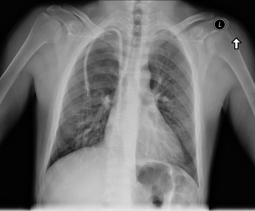
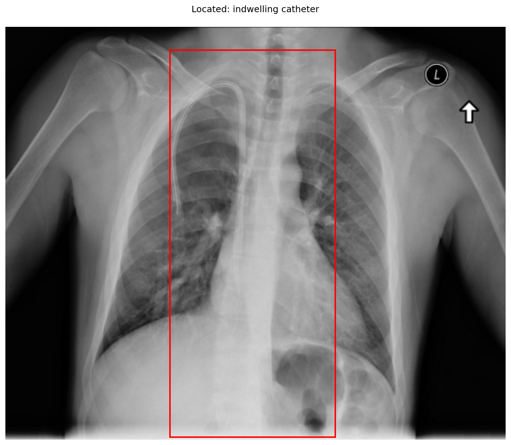

# chexbench_openi_0052
Ordinal 291; source OpenI; stopped-prefix record.

Which finding is in this chest X-ray?

## Complete options

- **A**: left indwelling catheter
- **B**: right indwelling catheter

## Original images

Explicit answer: **A. left indwelling catheter**; reference: **B**; correct: **False**.

The 'L' marker on the image indicates the patient's left side, and the catheter is visible entering from that side.

[Prediction](../../evidence/chexbench/predictions/M43-IM-GT-S50-CXR6/chexbench_openi_0052.json) · [own post-prediction feedback](../../evidence/chexbench/feedback/chexbench_openi_0052.json) · [exact context and Skill version](../../evidence/chexbench/contexts/chexbench_openi_0052.json) · [all main requests/responses](../../evidence/chexbench/services/calls/R50-AGENT/chexbench_openi_0052)

## Tool requests and observations

- xray_phrase_grounding: status=completed; [selection](../../evidence/chexbench/services/tool_selections/R50-AGENT/chexbench_openi_0052/1.json), [full request/result/stdout/stderr artifacts](../../evidence/chexbench/services/tool_cache/fb7ad01b462e8c998f110c6ba0d55e91da38c92bdb6fd30acfe48baf4113ae13).

## Skill and prior-image provenance

Selected IDs: []; prior same-image IDs: [].

This is dataset-label scoring and model/tool narrative, not clinical adjudication or Skill causal verification.
