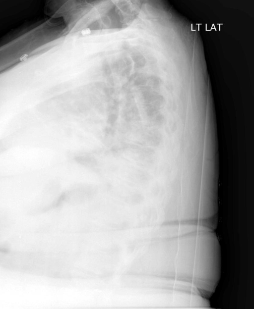
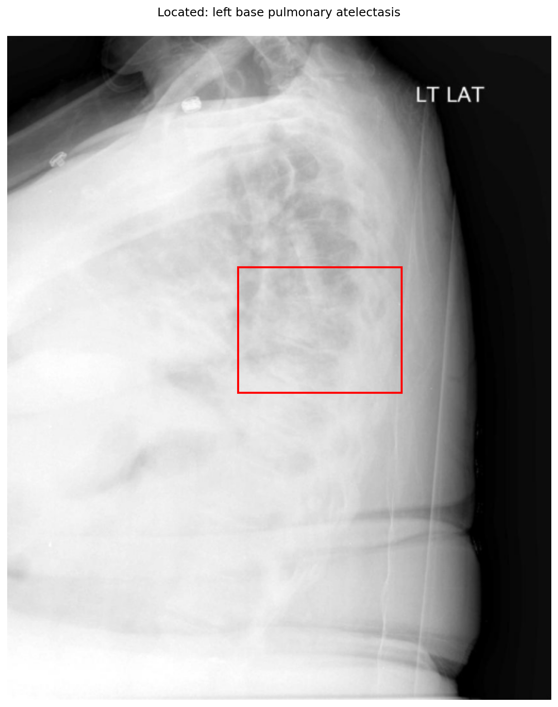

# chexbench_openi_0053
Ordinal 292; source OpenI; stopped-prefix record.

Which finding is in this chest X-ray?

## Complete options

- **A**: left base pulmonary atelectasis
- **B**: right base pulmonary atelectasis

## Original images

Explicit answer: **A. left base pulmonary atelectasis**; reference: **B**; correct: **False**.

Multiple models and phrase grounding confirm increased opacity consistent with left base atelectasis on this lateral chest X-ray.

[Prediction](../../evidence/chexbench/predictions/M43-IM-GT-S50-CXR6/chexbench_openi_0053.json) · [own post-prediction feedback](../../evidence/chexbench/feedback/chexbench_openi_0053.json) · [exact context and Skill version](../../evidence/chexbench/contexts/chexbench_openi_0053.json) · [all main requests/responses](../../evidence/chexbench/services/calls/R50-AGENT/chexbench_openi_0053)

## Tool requests and observations

- medgemma: status=completed; [selection](../../evidence/chexbench/services/tool_selections/R50-AGENT/chexbench_openi_0053/1.json), [full request/result/stdout/stderr artifacts](../../evidence/chexbench/services/tool_cache/ad495a00f1d6e56786c64704cf5f180420e9b81cc1480250b0e1ba59ce288d92).
- chest_xray_expert: status=completed; [selection](../../evidence/chexbench/services/tool_selections/R50-AGENT/chexbench_openi_0053/2.json), [full request/result/stdout/stderr artifacts](../../evidence/chexbench/services/tool_cache/14f9b096f3322bebba74040223a000eda4b8ac18b1692b48532bacb2d97988a0).
- xray_phrase_grounding: status=completed; [selection](../../evidence/chexbench/services/tool_selections/R50-AGENT/chexbench_openi_0053/3.json), [full request/result/stdout/stderr artifacts](../../evidence/chexbench/services/tool_cache/b68c3f2862afb01498be07c7d6f68dd9321998637b18caeb837ef56f44c5e4a2).

## Skill and prior-image provenance

Selected IDs: []; prior same-image IDs: [].

This is dataset-label scoring and model/tool narrative, not clinical adjudication or Skill causal verification.
