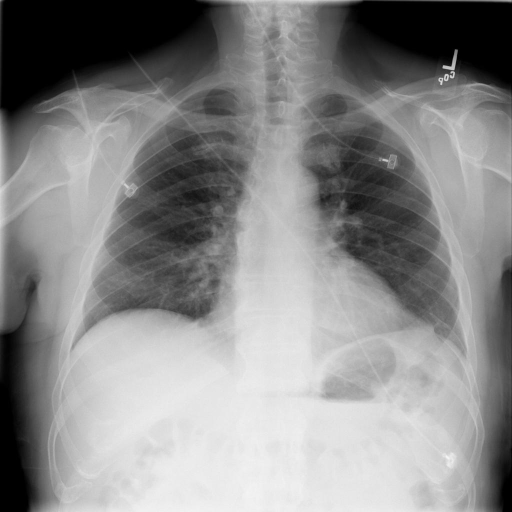
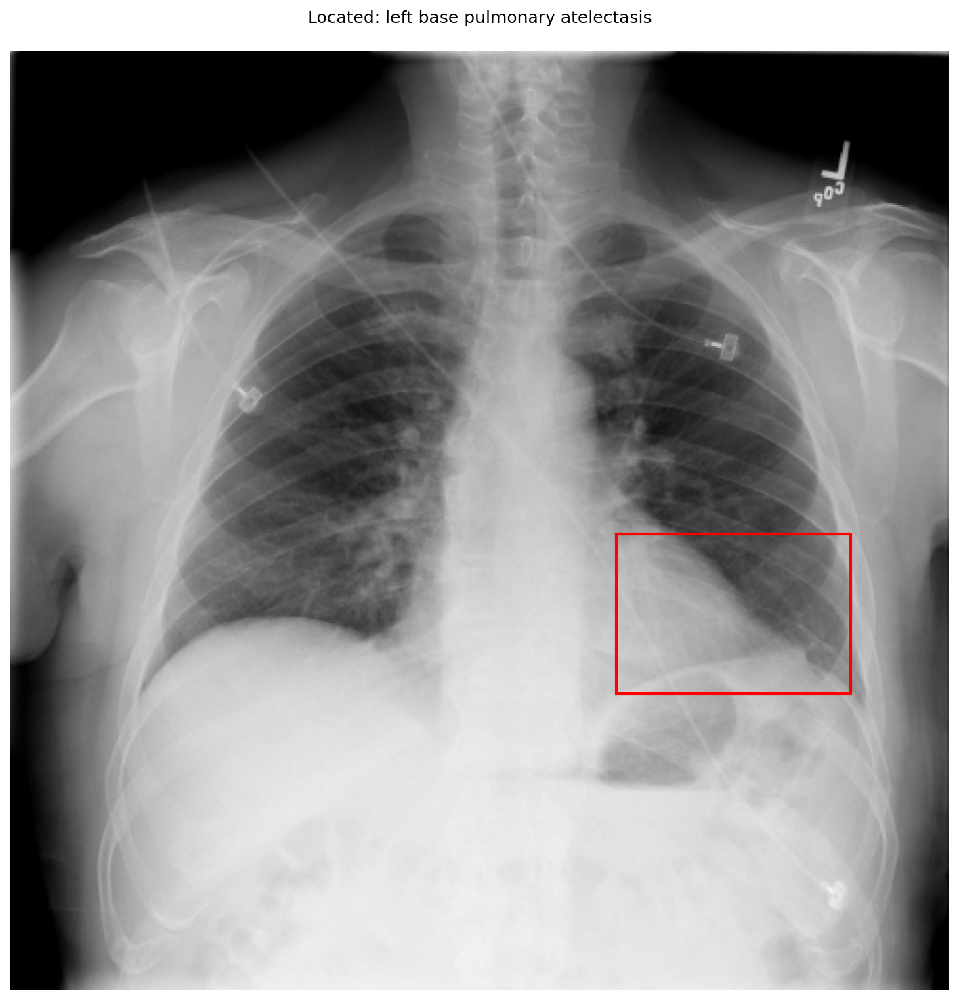

# chexbench_openi_0054
Ordinal 293; source OpenI; stopped-prefix record.

Which finding is in this chest X-ray?

## Complete options

- **A**: left base pulmonary atelectasis
- **B**: right base pulmonary atelectasis

## Original images

Explicit answer: **A. left base pulmonary atelectasis**; reference: **A**; correct: **True**.

Phrase grounding and CheXagent both localize the finding to the left lung base, consistent with the visible opacity in that region.

[Prediction](../../evidence/chexbench/predictions/M43-IM-GT-S50-CXR6/chexbench_openi_0054.json) · [own post-prediction feedback](../../evidence/chexbench/feedback/chexbench_openi_0054.json) · [exact context and Skill version](../../evidence/chexbench/contexts/chexbench_openi_0054.json) · [all main requests/responses](../../evidence/chexbench/services/calls/R50-AGENT/chexbench_openi_0054)

## Tool requests and observations

- medgemma: status=completed; [selection](../../evidence/chexbench/services/tool_selections/R50-AGENT/chexbench_openi_0054/1.json), [full request/result/stdout/stderr artifacts](../../evidence/chexbench/services/tool_cache/0df268fba4771cbfbf7ab1d88a521983f456ec79026fedb015ded89acc87c0cc).
- llava_rad: status=completed; [selection](../../evidence/chexbench/services/tool_selections/R50-AGENT/chexbench_openi_0054/2.json), [full request/result/stdout/stderr artifacts](../../evidence/chexbench/services/tool_cache/1fbc34d3092b9b4a41e033682ee380552cf2b39bfdebee97e69ede0aba0458d0).
- chest_xray_expert: status=completed; [selection](../../evidence/chexbench/services/tool_selections/R50-AGENT/chexbench_openi_0054/3.json), [full request/result/stdout/stderr artifacts](../../evidence/chexbench/services/tool_cache/0c4151047e1c02d6873bf8dc6730f30efe981ef14585c50ef4fb7cbc835d1926).
- xray_phrase_grounding: status=completed; [selection](../../evidence/chexbench/services/tool_selections/R50-AGENT/chexbench_openi_0054/4.json), [full request/result/stdout/stderr artifacts](../../evidence/chexbench/services/tool_cache/0fc58206a1f1994e6469095caa21c200062f85fcd81e7e2ad7a7c122e7387311).

## Skill and prior-image provenance

Selected IDs: []; prior same-image IDs: [].

This is dataset-label scoring and model/tool narrative, not clinical adjudication or Skill causal verification.
