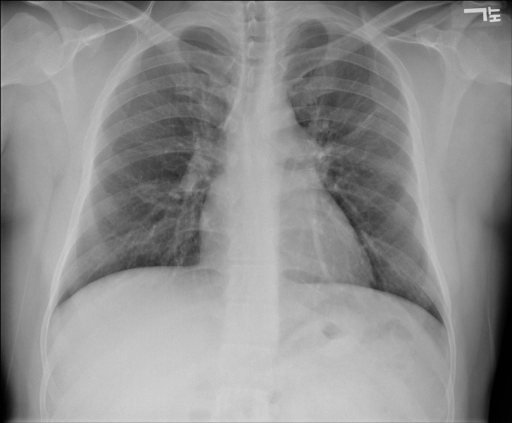
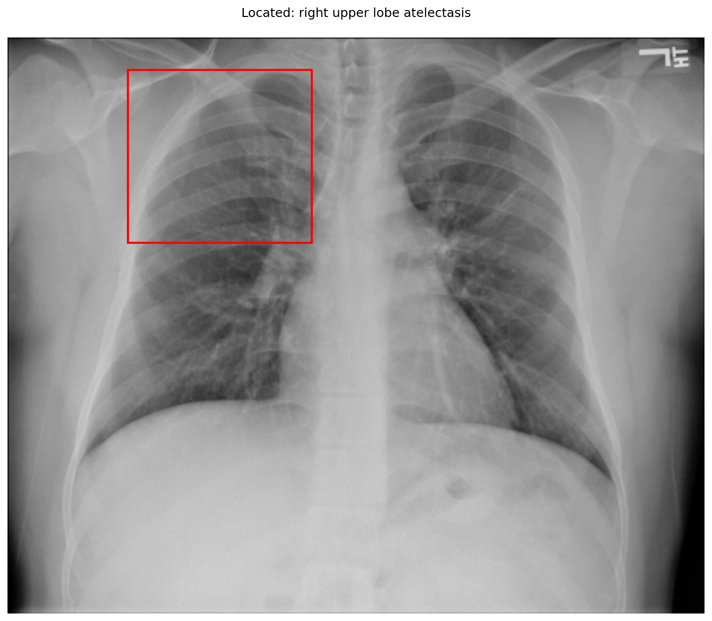
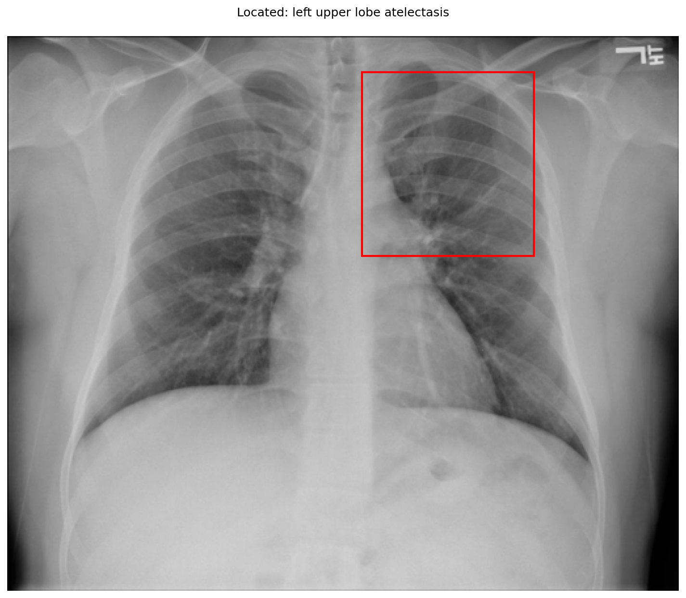

# chexbench_openi_0055
Ordinal 294; source OpenI; stopped-prefix record.

Which finding is in this chest X-ray?

## Complete options

- **A**: right upper lobe pulmonary atelectasis
- **B**: left upper lobe pulmonary atelectasis

## Original images

Explicit answer: **A. right upper lobe pulmonary atelectasis**; reference: **B**; correct: **False**.

The grounding visualization highlights opacity and volume loss in the right upper zone consistent with RUL atelectasis, while the left upper lobe appears aerated.

[Prediction](../../evidence/chexbench/predictions/M43-IM-GT-S50-CXR6/chexbench_openi_0055.json) · [own post-prediction feedback](../../evidence/chexbench/feedback/chexbench_openi_0055.json) · [exact context and Skill version](../../evidence/chexbench/contexts/chexbench_openi_0055.json) · [all main requests/responses](../../evidence/chexbench/services/calls/R50-AGENT/chexbench_openi_0055)

## Tool requests and observations

- chest_xray_expert: status=completed; [selection](../../evidence/chexbench/services/tool_selections/R50-AGENT/chexbench_openi_0055/1.json), [full request/result/stdout/stderr artifacts](../../evidence/chexbench/services/tool_cache/92665c3fde673cad0d9b5740593fcc1130266f43ba8db92a976d95b40575d198).
- xray_phrase_grounding: status=completed; [selection](../../evidence/chexbench/services/tool_selections/R50-AGENT/chexbench_openi_0055/2.json), [full request/result/stdout/stderr artifacts](../../evidence/chexbench/services/tool_cache/5e11e2813e48c28a8123715935e736b23b26ed08b546adb5671a1694bf6cbf8d).

- xray_phrase_grounding: status=completed; [selection](../../evidence/chexbench/services/tool_selections/R50-AGENT/chexbench_openi_0055/3.json), [full request/result/stdout/stderr artifacts](../../evidence/chexbench/services/tool_cache/1c95f4be7a5c2167a7fb50a43e14df2ce57e8e7e77a3c58fa895a6391eb8e749).

## Skill and prior-image provenance

Selected IDs: []; prior same-image IDs: [].

This is dataset-label scoring and model/tool narrative, not clinical adjudication or Skill causal verification.
