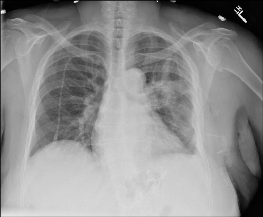
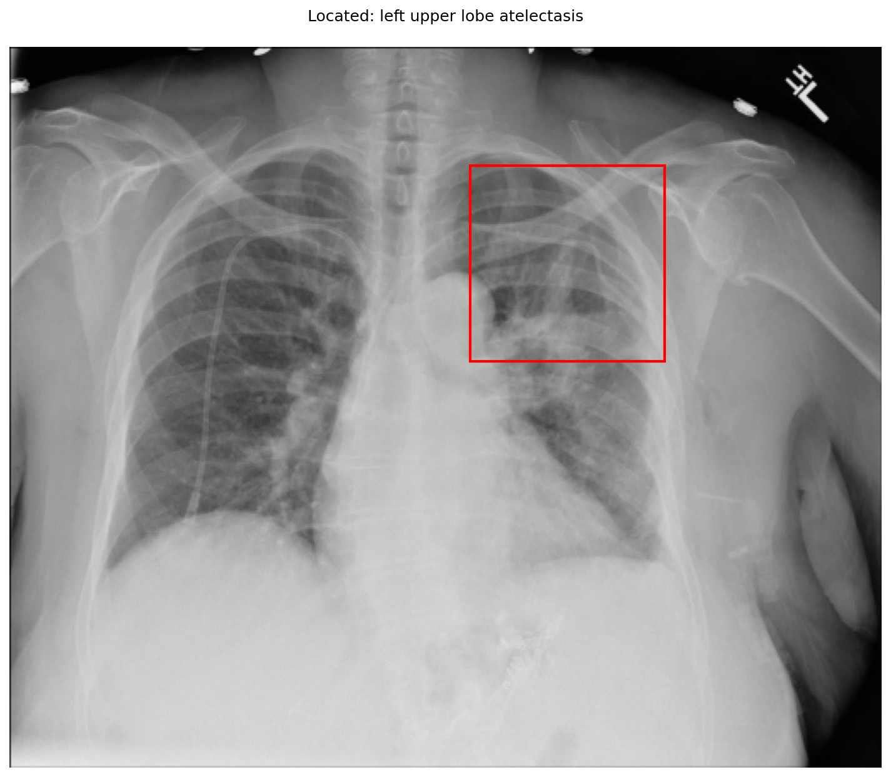

# chexbench_openi_0056
Ordinal 295; source OpenI; stopped-prefix record.

Which finding is in this chest X-ray?

## Complete options

- **A**: left upper lobe pulmonary atelectasis
- **B**: right upper lobe pulmonary atelectasis

## Original images

Explicit answer: **A. left upper lobe pulmonary atelectasis**; reference: **A**; correct: **True**.

Phrase grounding and expert models localize opacity and volume loss to the left upper lobe, consistent with atelectasis.

[Prediction](../../evidence/chexbench/predictions/M43-IM-GT-S50-CXR6/chexbench_openi_0056.json) · [own post-prediction feedback](../../evidence/chexbench/feedback/chexbench_openi_0056.json) · [exact context and Skill version](../../evidence/chexbench/contexts/chexbench_openi_0056.json) · [all main requests/responses](../../evidence/chexbench/services/calls/R50-AGENT/chexbench_openi_0056)

## Tool requests and observations

- medgemma: status=completed; [selection](../../evidence/chexbench/services/tool_selections/R50-AGENT/chexbench_openi_0056/1.json), [full request/result/stdout/stderr artifacts](../../evidence/chexbench/services/tool_cache/1c1be0631d9a3b2aef51fd37a37357ae5d2f8b70440cdcffc5018c006234cf8d).
- chest_xray_expert: status=completed; [selection](../../evidence/chexbench/services/tool_selections/R50-AGENT/chexbench_openi_0056/2.json), [full request/result/stdout/stderr artifacts](../../evidence/chexbench/services/tool_cache/8b330d22b7bb4a066a84aa086dab56bf9904dfcc4c01d7bb64c371c926242f1a).
- xray_phrase_grounding: status=completed; [selection](../../evidence/chexbench/services/tool_selections/R50-AGENT/chexbench_openi_0056/3.json), [full request/result/stdout/stderr artifacts](../../evidence/chexbench/services/tool_cache/f00bd16d1920724d1f3fed549f5ac5075c26726a8b0ffdf4a10232ab58d7ceb0).

## Skill and prior-image provenance

Selected IDs: []; prior same-image IDs: [].

This is dataset-label scoring and model/tool narrative, not clinical adjudication or Skill causal verification.
