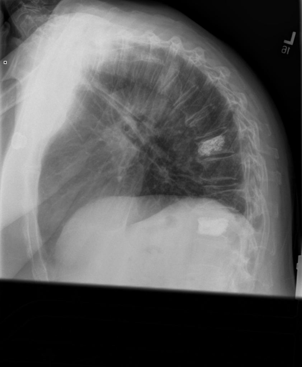

# chexbench_openi_0057
Ordinal 296; source OpenI; stopped-prefix record.

Which finding is in this chest X-ray?

## Complete options

- **A**: right indwelling catheter
- **B**: left indwelling catheter

## Original images

Explicit answer: **A. right indwelling catheter**; reference: **A**; correct: **True**.

Two expert models (chest_xray_expert and llava_rad) identify a right-sided catheter/PICC line, while grounding failed to detect it; the consensus supports the right side.

[Prediction](../../evidence/chexbench/predictions/M43-IM-GT-S50-CXR6/chexbench_openi_0057.json) · [own post-prediction feedback](../../evidence/chexbench/feedback/chexbench_openi_0057.json) · [exact context and Skill version](../../evidence/chexbench/contexts/chexbench_openi_0057.json) · [all main requests/responses](../../evidence/chexbench/services/calls/R50-AGENT/chexbench_openi_0057)

## Tool requests and observations

- medgemma: status=completed; [selection](../../evidence/chexbench/services/tool_selections/R50-AGENT/chexbench_openi_0057/1.json), [full request/result/stdout/stderr artifacts](../../evidence/chexbench/services/tool_cache/f1da2d7084feabb44ca25c24c6ba761869e1772cf5e9bebd51ccd28c24349d3b).
- chest_xray_expert: status=completed; [selection](../../evidence/chexbench/services/tool_selections/R50-AGENT/chexbench_openi_0057/2.json), [full request/result/stdout/stderr artifacts](../../evidence/chexbench/services/tool_cache/fd08ea69a549093a11ee6bf10b044dbf600648bfaafe0241dce0f03fd5fc33ee).
- xray_phrase_grounding: status=completed; [selection](../../evidence/chexbench/services/tool_selections/R50-AGENT/chexbench_openi_0057/3.json), [full request/result/stdout/stderr artifacts](../../evidence/chexbench/services/tool_cache/1ed97f5741defd7edfe2e17856cda4679d907da3451f4d0c6cf65c019f0350ef).
- llava_rad: status=completed; [selection](../../evidence/chexbench/services/tool_selections/R50-AGENT/chexbench_openi_0057/4.json), [full request/result/stdout/stderr artifacts](../../evidence/chexbench/services/tool_cache/0f04ad8ee8c765bf1defacb03963414a0015c35d6aae5ce3f2433a5fcbb0b130).

## Skill and prior-image provenance

Selected IDs: []; prior same-image IDs: [].

This is dataset-label scoring and model/tool narrative, not clinical adjudication or Skill causal verification.
