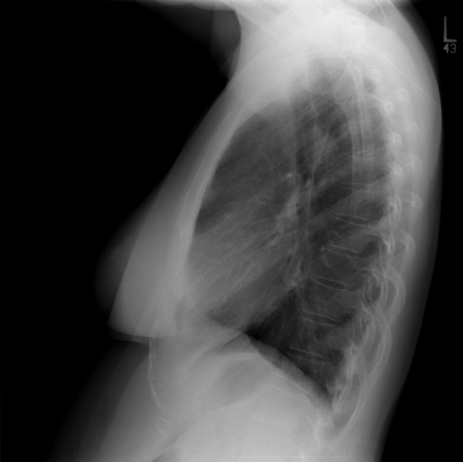

# chexbench_openi_0058
Ordinal 297; source OpenI; stopped-prefix record.

Which finding is in this chest X-ray?

## Complete options

- **A**: left lower lobe pulmonary atelectasis
- **B**: right lower lobe pulmonary atelectasis

## Original images

Explicit answer: **A. left lower lobe pulmonary atelectasis**; reference: **B**; correct: **False**.

LLaVA-Med identified increased retrocardiac opacity on the lateral view, which is the characteristic sign of left lower lobe atelectasis.

[Prediction](../../evidence/chexbench/predictions/M43-IM-GT-S50-CXR6/chexbench_openi_0058.json) · [own post-prediction feedback](../../evidence/chexbench/feedback/chexbench_openi_0058.json) · [exact context and Skill version](../../evidence/chexbench/contexts/chexbench_openi_0058.json) · [all main requests/responses](../../evidence/chexbench/services/calls/R50-AGENT/chexbench_openi_0058)

## Tool requests and observations

- medgemma: status=completed; [selection](../../evidence/chexbench/services/tool_selections/R50-AGENT/chexbench_openi_0058/1.json), [full request/result/stdout/stderr artifacts](../../evidence/chexbench/services/tool_cache/d5905d48ead53d609e28a28f38cc45727f67e525d855b53c8f4c1a198971d195).
- llava_rad: status=completed; [selection](../../evidence/chexbench/services/tool_selections/R50-AGENT/chexbench_openi_0058/2.json), [full request/result/stdout/stderr artifacts](../../evidence/chexbench/services/tool_cache/3a08f3d51af0885d1dd43446fb1da87bb42dc8f05b754aa6fa1cc7a465119ddd).
- chest_xray_expert: status=completed; [selection](../../evidence/chexbench/services/tool_selections/R50-AGENT/chexbench_openi_0058/3.json), [full request/result/stdout/stderr artifacts](../../evidence/chexbench/services/tool_cache/e6534b91323a078318d55b2e47753f768193cdf6bebd49349914eb3a8a5f7e48).
- medvlm_r1: status=completed; [selection](../../evidence/chexbench/services/tool_selections/R50-AGENT/chexbench_openi_0058/4.json), [full request/result/stdout/stderr artifacts](../../evidence/chexbench/services/tool_cache/718f4ddb293d67f07fafd138295fec7ad51fc1f68217ae49276e27c52a7fdcac).
- llava_med_qa: status=completed; [selection](../../evidence/chexbench/services/tool_selections/R50-AGENT/chexbench_openi_0058/5.json), [full request/result/stdout/stderr artifacts](../../evidence/chexbench/services/tool_cache/dace7b825078b811263ac54e83a4e78c560afe6eb803e412bf0df9c1f994ffd3).

## Skill and prior-image provenance

Selected IDs: []; prior same-image IDs: [].

This is dataset-label scoring and model/tool narrative, not clinical adjudication or Skill causal verification.
