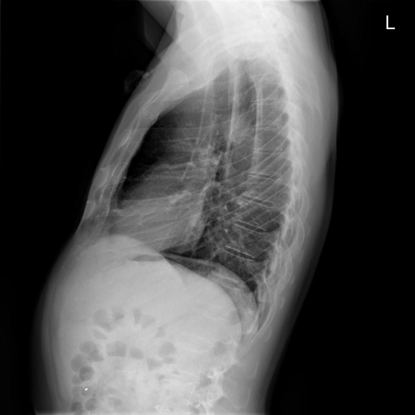

# chexbench_openi_0059
Ordinal 298; source OpenI; stopped-prefix record.

Which finding is in this chest X-ray?

## Complete options

- **A**: left indwelling catheter
- **B**: right indwelling catheter

## Original images

Explicit answer: **B. right indwelling catheter**; reference: **B**; correct: **True**.

Expert VQA confirmed the presence of a right-sided indwelling catheter in this lateral chest X-ray.

[Prediction](../../evidence/chexbench/predictions/M43-IM-GT-S50-CXR6/chexbench_openi_0059.json) · [own post-prediction feedback](../../evidence/chexbench/feedback/chexbench_openi_0059.json) · [exact context and Skill version](../../evidence/chexbench/contexts/chexbench_openi_0059.json) · [all main requests/responses](../../evidence/chexbench/services/calls/R50-AGENT/chexbench_openi_0059)

## Tool requests and observations

- xray_phrase_grounding: status=completed; [selection](../../evidence/chexbench/services/tool_selections/R50-AGENT/chexbench_openi_0059/1.json), [full request/result/stdout/stderr artifacts](../../evidence/chexbench/services/tool_cache/5950b08590aff034fdc5672eecf700a685dd315ebf811bc8ff73bf8886b520bd).
- chest_xray_expert: status=completed; [selection](../../evidence/chexbench/services/tool_selections/R50-AGENT/chexbench_openi_0059/2.json), [full request/result/stdout/stderr artifacts](../../evidence/chexbench/services/tool_cache/4bf7f4ff4cd2a5de70da54fa385a4b925522bd3b5d5c3beee07a3bae0e1e0d04).
- chest_xray_expert: status=completed; [selection](../../evidence/chexbench/services/tool_selections/R50-AGENT/chexbench_openi_0059/3.json), [full request/result/stdout/stderr artifacts](../../evidence/chexbench/services/tool_cache/8774bddee62b8c8c35a80bf51286ba916726ba1da7e965b48791e9ff7a2cb0d3).

## Skill and prior-image provenance

Selected IDs: []; prior same-image IDs: [].

This is dataset-label scoring and model/tool narrative, not clinical adjudication or Skill causal verification.
