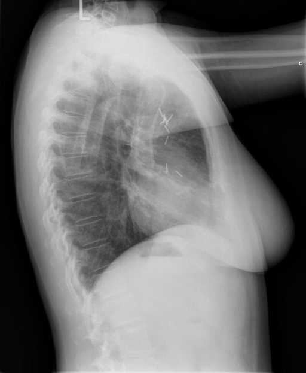

# chexbench_openi_0060
Ordinal 299; source OpenI; stopped-prefix record.

Which finding is in this chest X-ray?

## Complete options

- **A**: left indwelling catheter
- **B**: right indwelling catheter

## Original images

Explicit answer: **A. left indwelling catheter**; reference: **A**; correct: **True**.

The chest_xray_expert model identified the visible indwelling catheter as being on the left side.

[Prediction](../../evidence/chexbench/predictions/M43-IM-GT-S50-CXR6/chexbench_openi_0060.json) · [own post-prediction feedback](../../evidence/chexbench/feedback/chexbench_openi_0060.json) · [exact context and Skill version](../../evidence/chexbench/contexts/chexbench_openi_0060.json) · [all main requests/responses](../../evidence/chexbench/services/calls/R50-AGENT/chexbench_openi_0060)

## Tool requests and observations

- xray_phrase_grounding: status=completed; [selection](../../evidence/chexbench/services/tool_selections/R50-AGENT/chexbench_openi_0060/1.json), [full request/result/stdout/stderr artifacts](../../evidence/chexbench/services/tool_cache/77d609cbf9e242a0f320c53bd753bac61ceb0380cff27300221345d5e1f50cd1).
- chest_xray_expert: status=completed; [selection](../../evidence/chexbench/services/tool_selections/R50-AGENT/chexbench_openi_0060/2.json), [full request/result/stdout/stderr artifacts](../../evidence/chexbench/services/tool_cache/dc1b5fba9a1f84f20f5e2d772d2772c75e5ed55f9f40350843e3b76cd6cf2657).

## Skill and prior-image provenance

Selected IDs: []; prior same-image IDs: [].

This is dataset-label scoring and model/tool narrative, not clinical adjudication or Skill causal verification.
