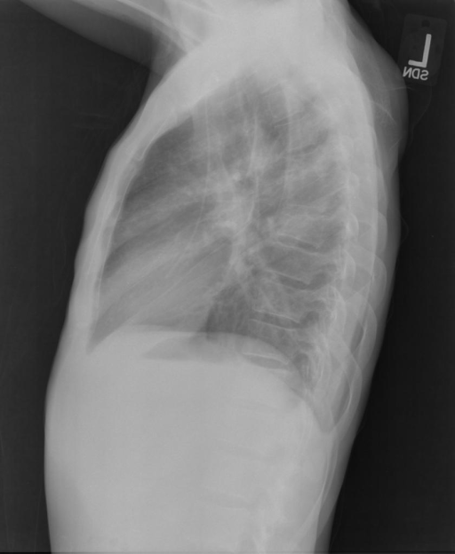

# chexbench_openi_0061
Ordinal 300; source OpenI; stopped-prefix record.

Which finding is in this chest X-ray?

## Complete options

- **A**: right indwelling catheter
- **B**: left indwelling catheter

## Original images

Explicit answer: **A. right indwelling catheter**; reference: **A**; correct: **True**.

Both medgemma and chest_xray_expert models identified a right-sided indwelling catheter in the lateral chest X-ray.

[Prediction](../../evidence/chexbench/predictions/M43-IM-GT-S50-CXR6/chexbench_openi_0061.json) · [own post-prediction feedback](../../evidence/chexbench/feedback/chexbench_openi_0061.json) · [exact context and Skill version](../../evidence/chexbench/contexts/chexbench_openi_0061.json) · [all main requests/responses](../../evidence/chexbench/services/calls/R50-AGENT/chexbench_openi_0061)

## Tool requests and observations

- medgemma: status=completed; [selection](../../evidence/chexbench/services/tool_selections/R50-AGENT/chexbench_openi_0061/1.json), [full request/result/stdout/stderr artifacts](../../evidence/chexbench/services/tool_cache/19aaebee6362e72a7a2cbd74ef4ae0f04cae44512ed28e6bd4063f8afb738991).
- chest_xray_expert: status=completed; [selection](../../evidence/chexbench/services/tool_selections/R50-AGENT/chexbench_openi_0061/2.json), [full request/result/stdout/stderr artifacts](../../evidence/chexbench/services/tool_cache/55917e367ea21d98fdda3781d1a5aff69b9dce42c9c1db6ac88b8244951c3cc7).

## Skill and prior-image provenance

Selected IDs: []; prior same-image IDs: [].

This is dataset-label scoring and model/tool narrative, not clinical adjudication or Skill causal verification.
