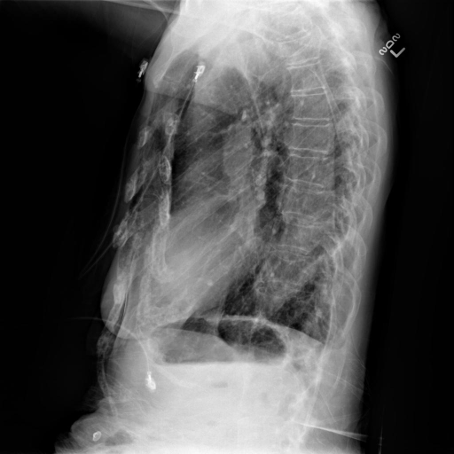
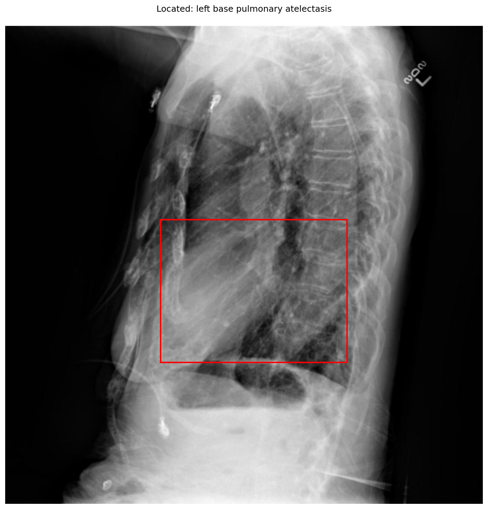

# chexbench_openi_0062
Ordinal 301; source OpenI; stopped-prefix record.

Which finding is in this chest X-ray?

## Complete options

- **A**: left base pulmonary atelectasis
- **B**: right base pulmonary atelectasis

## Original images

Explicit answer: **A. left base pulmonary atelectasis**; reference: **B**; correct: **False**.

Phrase grounding visually localized left base atelectasis in the lateral view, and llava_rad explicitly identified this finding.

[Prediction](../../evidence/chexbench/predictions/M43-IM-GT-S50-CXR6/chexbench_openi_0062.json) · [own post-prediction feedback](../../evidence/chexbench/feedback/chexbench_openi_0062.json) · [exact context and Skill version](../../evidence/chexbench/contexts/chexbench_openi_0062.json) · [all main requests/responses](../../evidence/chexbench/services/calls/R50-AGENT/chexbench_openi_0062)

## Tool requests and observations

- medgemma: status=completed; [selection](../../evidence/chexbench/services/tool_selections/R50-AGENT/chexbench_openi_0062/1.json), [full request/result/stdout/stderr artifacts](../../evidence/chexbench/services/tool_cache/6aa0171694ccf156041da159ac60e1fb588c6f2aa7cc96cb3b3974dd5fe645b1).
- chest_xray_expert: status=completed; [selection](../../evidence/chexbench/services/tool_selections/R50-AGENT/chexbench_openi_0062/2.json), [full request/result/stdout/stderr artifacts](../../evidence/chexbench/services/tool_cache/738cea67ae6452acd8567607eecbbaf1fae8e8d17309774d099840b289972683).
- llava_rad: status=completed; [selection](../../evidence/chexbench/services/tool_selections/R50-AGENT/chexbench_openi_0062/3.json), [full request/result/stdout/stderr artifacts](../../evidence/chexbench/services/tool_cache/d9a5e88047ab6adc297d21b6843b1f445022e8adba6bd050e641c775ad14cb00).
- xray_phrase_grounding: status=completed; [selection](../../evidence/chexbench/services/tool_selections/R50-AGENT/chexbench_openi_0062/4.json), [full request/result/stdout/stderr artifacts](../../evidence/chexbench/services/tool_cache/7b508f5210e365fdc10a830f6572a98c9eeebcbd5f50fdc6a1d0155ea9f881bd).

## Skill and prior-image provenance

Selected IDs: []; prior same-image IDs: [].

This is dataset-label scoring and model/tool narrative, not clinical adjudication or Skill causal verification.
