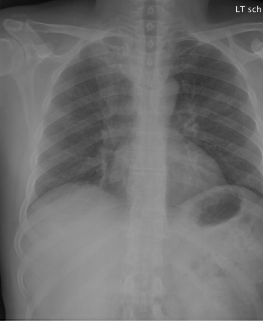
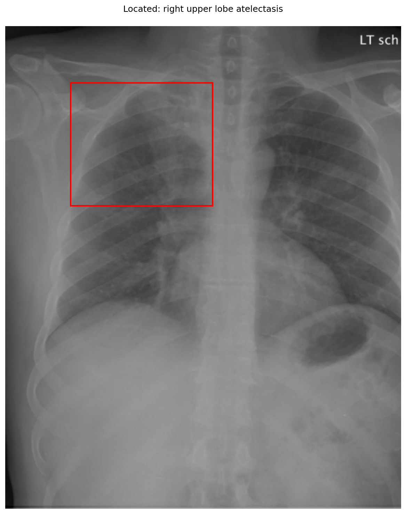

# chexbench_openi_0063
Ordinal 302; source OpenI; stopped-prefix record.

Which finding is in this chest X-ray?

## Complete options

- **A**: right upper lobe pulmonary atelectasis
- **B**: left upper lobe pulmonary atelectasis

## Original images

Explicit answer: **A. right upper lobe pulmonary atelectasis**; reference: **A**; correct: **True**.

Visual grounding confirms opacity in the right upper lung zone consistent with right upper lobe atelectasis.

[Prediction](../../evidence/chexbench/predictions/M43-IM-GT-S50-CXR6/chexbench_openi_0063.json) · [own post-prediction feedback](../../evidence/chexbench/feedback/chexbench_openi_0063.json) · [exact context and Skill version](../../evidence/chexbench/contexts/chexbench_openi_0063.json) · [all main requests/responses](../../evidence/chexbench/services/calls/R50-AGENT/chexbench_openi_0063)

## Tool requests and observations

- medgemma: status=completed; [selection](../../evidence/chexbench/services/tool_selections/R50-AGENT/chexbench_openi_0063/1.json), [full request/result/stdout/stderr artifacts](../../evidence/chexbench/services/tool_cache/33c4da090f23638608f5e94f4c5dfa65e872274b005a94ce16d6afd14e413f71).
- chest_xray_expert: status=completed; [selection](../../evidence/chexbench/services/tool_selections/R50-AGENT/chexbench_openi_0063/2.json), [full request/result/stdout/stderr artifacts](../../evidence/chexbench/services/tool_cache/79e36309dcc8c8ac6e78c7eea8f7b5cae8c07c9c7c515f12b8300e4443c283a2).
- xray_phrase_grounding: status=completed; [selection](../../evidence/chexbench/services/tool_selections/R50-AGENT/chexbench_openi_0063/3.json), [full request/result/stdout/stderr artifacts](../../evidence/chexbench/services/tool_cache/1d253bcc32b9131058ab8ffd98e5b54b5451324d3417671017b4c702e936f453).

## Skill and prior-image provenance

Selected IDs: []; prior same-image IDs: [].

This is dataset-label scoring and model/tool narrative, not clinical adjudication or Skill causal verification.
