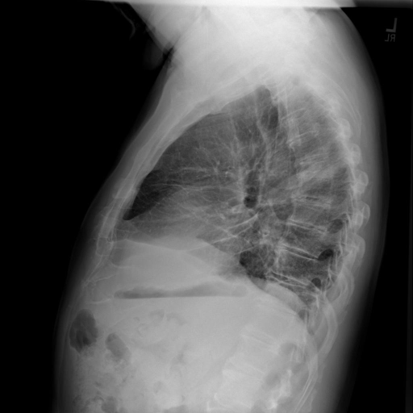
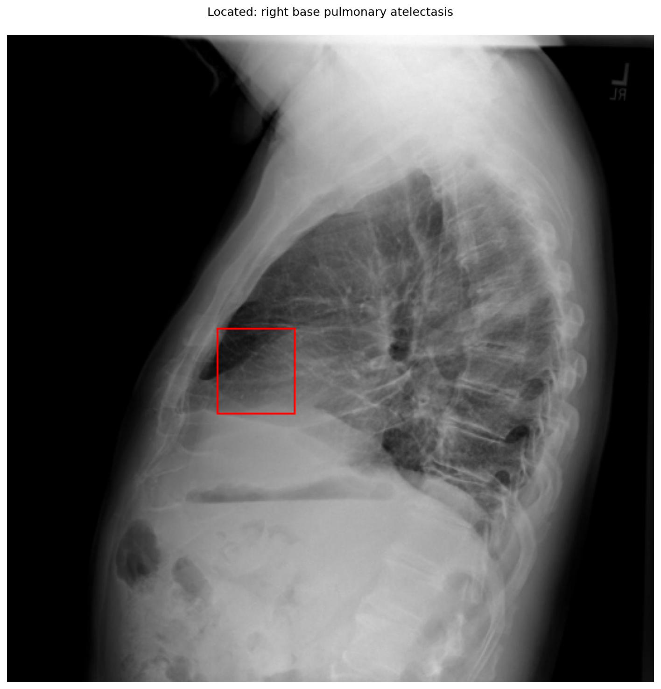

# chexbench_openi_0064
Ordinal 303; source OpenI; stopped-prefix record.

Which finding is in this chest X-ray?

## Complete options

- **A**: right base pulmonary atelectasis
- **B**: left base pulmonary atelectasis

## Original images

Explicit answer: **A. right base pulmonary atelectasis**; reference: **A**; correct: **True**.

Phrase grounding and expert models localize increased opacity consistent with right base atelectasis on the lateral view.

[Prediction](../../evidence/chexbench/predictions/M43-IM-GT-S50-CXR6/chexbench_openi_0064.json) · [own post-prediction feedback](../../evidence/chexbench/feedback/chexbench_openi_0064.json) · [exact context and Skill version](../../evidence/chexbench/contexts/chexbench_openi_0064.json) · [all main requests/responses](../../evidence/chexbench/services/calls/R50-AGENT/chexbench_openi_0064)

## Tool requests and observations

- medgemma: status=completed; [selection](../../evidence/chexbench/services/tool_selections/R50-AGENT/chexbench_openi_0064/1.json), [full request/result/stdout/stderr artifacts](../../evidence/chexbench/services/tool_cache/50bf8087c7dbcf4f375c20985428160e89c3b595ca4ecf6c24b4b40da176cac8).
- chest_xray_expert: status=completed; [selection](../../evidence/chexbench/services/tool_selections/R50-AGENT/chexbench_openi_0064/2.json), [full request/result/stdout/stderr artifacts](../../evidence/chexbench/services/tool_cache/697d38caef2762637ef43c92e08fb3a63fa8a10a76e73bd827b3a85f1ebed1ba).
- xray_phrase_grounding: status=completed; [selection](../../evidence/chexbench/services/tool_selections/R50-AGENT/chexbench_openi_0064/3.json), [full request/result/stdout/stderr artifacts](../../evidence/chexbench/services/tool_cache/fe060d58287e05460e7af85b1a8fc81749d1ce2c44c21f337a3520796d03ff56).

## Skill and prior-image provenance

Selected IDs: []; prior same-image IDs: [].

This is dataset-label scoring and model/tool narrative, not clinical adjudication or Skill causal verification.
