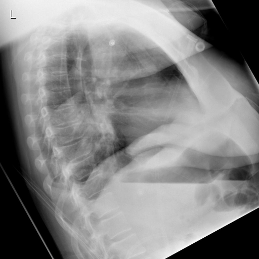
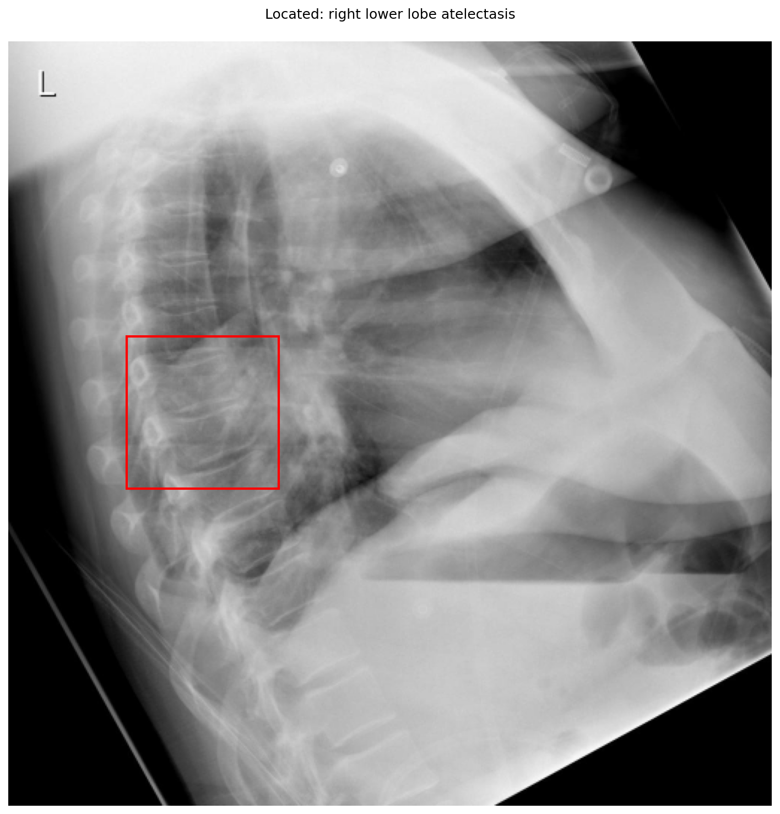

# chexbench_openi_0065
Ordinal 304; source OpenI; stopped-prefix record.

Which finding is in this chest X-ray?

## Complete options

- **A**: pulmonary atelectasis in the right lung
- **B**: pulmonary atelectasis in the left lung

## Original images

Explicit answer: **A. pulmonary atelectasis in the right lung**; reference: **A**; correct: **True**.

Multiple models and phrase grounding localize opacity/volume loss to the right lower lobe, confirming right-sided atelectasis.

[Prediction](../../evidence/chexbench/predictions/M43-IM-GT-S50-CXR6/chexbench_openi_0065.json) · [own post-prediction feedback](../../evidence/chexbench/feedback/chexbench_openi_0065.json) · [exact context and Skill version](../../evidence/chexbench/contexts/chexbench_openi_0065.json) · [all main requests/responses](../../evidence/chexbench/services/calls/R50-AGENT/chexbench_openi_0065)

## Tool requests and observations

- medgemma: status=completed; [selection](../../evidence/chexbench/services/tool_selections/R50-AGENT/chexbench_openi_0065/1.json), [full request/result/stdout/stderr artifacts](../../evidence/chexbench/services/tool_cache/408c5f72bd8d6e8525d3f24f127a52e7235efe42cfaa59e425626608f34cbf6d).
- llava_rad: status=completed; [selection](../../evidence/chexbench/services/tool_selections/R50-AGENT/chexbench_openi_0065/2.json), [full request/result/stdout/stderr artifacts](../../evidence/chexbench/services/tool_cache/35ec06c24b569c065c99e9f33427ce0d42a0d49abe85adee0bd82ac6327ee802).
- chest_xray_expert: status=completed; [selection](../../evidence/chexbench/services/tool_selections/R50-AGENT/chexbench_openi_0065/3.json), [full request/result/stdout/stderr artifacts](../../evidence/chexbench/services/tool_cache/d8217ae983997c59579768928fc2a4aec8110b9c83caf7da4e75e54e3f30b58c).
- xray_phrase_grounding: status=completed; [selection](../../evidence/chexbench/services/tool_selections/R50-AGENT/chexbench_openi_0065/4.json), [full request/result/stdout/stderr artifacts](../../evidence/chexbench/services/tool_cache/1e9e95cdf5181fed3df12d926cfa05d39da6d320539a3824388905cb0dcec3b3).

- medvlm_r1: status=completed; [selection](../../evidence/chexbench/services/tool_selections/R50-AGENT/chexbench_openi_0065/5.json), [full request/result/stdout/stderr artifacts](../../evidence/chexbench/services/tool_cache/4728c84fdb2b87385150e64ed1840567c50f65da339fff8c2d4fefeb0c7d5a23).

## Skill and prior-image provenance

Selected IDs: []; prior same-image IDs: [].

This is dataset-label scoring and model/tool narrative, not clinical adjudication or Skill causal verification.
