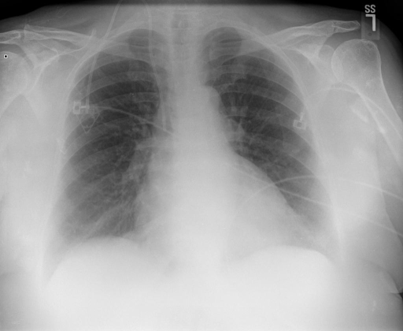
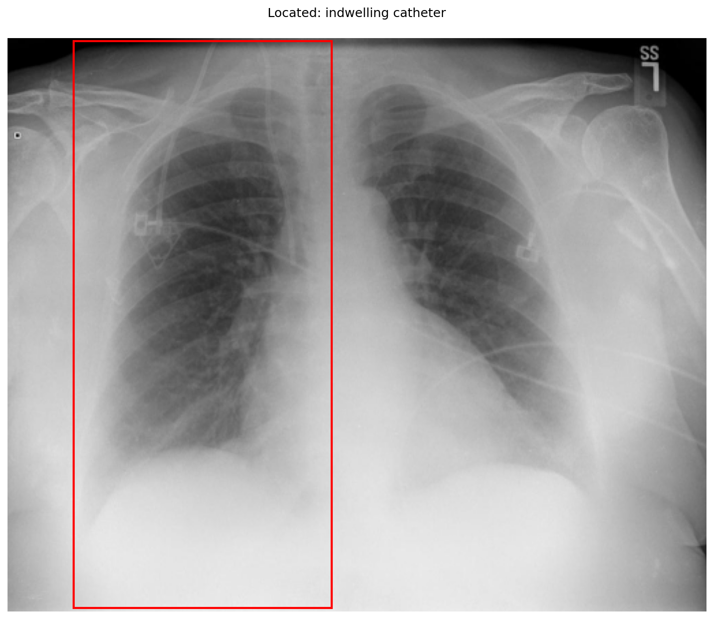

# chexbench_openi_0066
Ordinal 305; source OpenI; stopped-prefix record.

Which finding is in this chest X-ray?

## Complete options

- **A**: right indwelling catheter
- **B**: left indwelling catheter

## Original images

Explicit answer: **A. right indwelling catheter**; reference: **A**; correct: **True**.

The grounding box highlights a catheter device located in the right hemithorax (viewer's left), consistent with a right-sided indwelling catheter.

[Prediction](../../evidence/chexbench/predictions/M43-IM-GT-S50-CXR6/chexbench_openi_0066.json) · [own post-prediction feedback](../../evidence/chexbench/feedback/chexbench_openi_0066.json) · [exact context and Skill version](../../evidence/chexbench/contexts/chexbench_openi_0066.json) · [all main requests/responses](../../evidence/chexbench/services/calls/R50-AGENT/chexbench_openi_0066)

## Tool requests and observations

- xray_phrase_grounding: status=completed; [selection](../../evidence/chexbench/services/tool_selections/R50-AGENT/chexbench_openi_0066/1.json), [full request/result/stdout/stderr artifacts](../../evidence/chexbench/services/tool_cache/3d643cf7cc541e1e6198d5db19456cff486d512f2c181c6f9b4a714e8fdd3721).

## Skill and prior-image provenance

Selected IDs: []; prior same-image IDs: [].

This is dataset-label scoring and model/tool narrative, not clinical adjudication or Skill causal verification.
