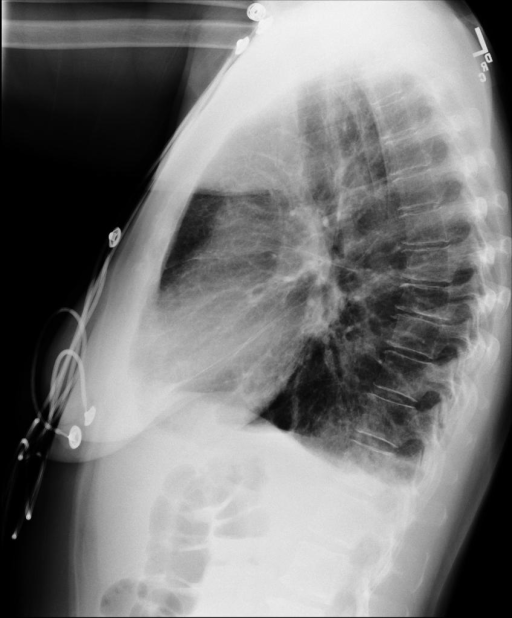
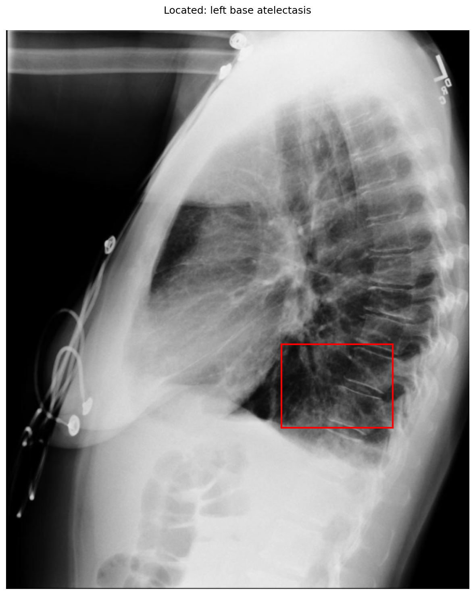

# chexbench_openi_0067
Ordinal 306; source OpenI; stopped-prefix record.

Which finding is in this chest X-ray?

## Complete options

- **A**: right base pulmonary atelectasis
- **B**: left base pulmonary atelectasis

## Original images

Explicit answer: **B. left base pulmonary atelectasis**; reference: **B**; correct: **True**.

Phrase grounding localized increased opacity to the left lower lung zone consistent with basal atelectasis, while right base grounding returned no finding.

[Prediction](../../evidence/chexbench/predictions/M43-IM-GT-S50-CXR6/chexbench_openi_0067.json) · [own post-prediction feedback](../../evidence/chexbench/feedback/chexbench_openi_0067.json) · [exact context and Skill version](../../evidence/chexbench/contexts/chexbench_openi_0067.json) · [all main requests/responses](../../evidence/chexbench/services/calls/R50-AGENT/chexbench_openi_0067)

## Tool requests and observations

- medgemma: status=completed; [selection](../../evidence/chexbench/services/tool_selections/R50-AGENT/chexbench_openi_0067/1.json), [full request/result/stdout/stderr artifacts](../../evidence/chexbench/services/tool_cache/2822bef1b498436de18bcba47116e351abf93aee686ac1baab6e81b36fcdcaf9).
- chest_xray_expert: status=completed; [selection](../../evidence/chexbench/services/tool_selections/R50-AGENT/chexbench_openi_0067/2.json), [full request/result/stdout/stderr artifacts](../../evidence/chexbench/services/tool_cache/e8156996058cc528ec5f5c99229533e5819a0f74ebdeae977ea6e51531102b02).
- llava_rad: status=completed; [selection](../../evidence/chexbench/services/tool_selections/R50-AGENT/chexbench_openi_0067/3.json), [full request/result/stdout/stderr artifacts](../../evidence/chexbench/services/tool_cache/c86f58597d8f93163ad2162961ff01df7fdf489bafd412fa4ede4ed3e7ae9655).
- xray_phrase_grounding: status=completed; [selection](../../evidence/chexbench/services/tool_selections/R50-AGENT/chexbench_openi_0067/4.json), [full request/result/stdout/stderr artifacts](../../evidence/chexbench/services/tool_cache/2304f909c200e62c0fd8e7dc5460f23204e2e23e3b9f1fefce98e1339f542074).
- xray_phrase_grounding: status=completed; [selection](../../evidence/chexbench/services/tool_selections/R50-AGENT/chexbench_openi_0067/5.json), [full request/result/stdout/stderr artifacts](../../evidence/chexbench/services/tool_cache/ba23c010ee380f3eca797e85a6ed31fe03f67167cf51f3a8f96055dd2a3ef55a).

## Skill and prior-image provenance

Selected IDs: []; prior same-image IDs: [].

This is dataset-label scoring and model/tool narrative, not clinical adjudication or Skill causal verification.
