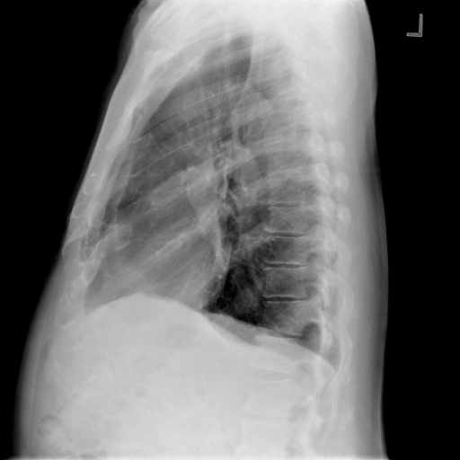

# chexbench_openi_0068
Ordinal 307; source OpenI; stopped-prefix record.

Which finding is in this chest X-ray?

## Complete options

- **A**: left base pulmonary atelectasis
- **B**: right base pulmonary atelectasis

## Original images

Explicit answer: **A. left base pulmonary atelectasis**; reference: **A**; correct: **True**.

MedGemma identified left base opacity suggestive of atelectasis, while grounding tools failed to localize either side and other models were non-diagnostic or negative; left base is the only positive finding reported.

[Prediction](../../evidence/chexbench/predictions/M43-IM-GT-S50-CXR6/chexbench_openi_0068.json) · [own post-prediction feedback](../../evidence/chexbench/feedback/chexbench_openi_0068.json) · [exact context and Skill version](../../evidence/chexbench/contexts/chexbench_openi_0068.json) · [all main requests/responses](../../evidence/chexbench/services/calls/R50-AGENT/chexbench_openi_0068)

## Tool requests and observations

- medgemma: status=completed; [selection](../../evidence/chexbench/services/tool_selections/R50-AGENT/chexbench_openi_0068/1.json), [full request/result/stdout/stderr artifacts](../../evidence/chexbench/services/tool_cache/b61399533138a10de4d1971b720311059a101ec8620fb39b64c04509877e5113).
- chest_xray_expert: status=completed; [selection](../../evidence/chexbench/services/tool_selections/R50-AGENT/chexbench_openi_0068/2.json), [full request/result/stdout/stderr artifacts](../../evidence/chexbench/services/tool_cache/b99edb7f6eb42fcc71befa28e4d25642c2b6bf4312e11bd638a1e98ce9f003f2).
- xray_phrase_grounding: status=completed; [selection](../../evidence/chexbench/services/tool_selections/R50-AGENT/chexbench_openi_0068/3.json), [full request/result/stdout/stderr artifacts](../../evidence/chexbench/services/tool_cache/b02c1ca1fc6f3b128ec65d0ff4784b898d16f0f84430ac70da222336b2ba9a89).
- xray_phrase_grounding: status=completed; [selection](../../evidence/chexbench/services/tool_selections/R50-AGENT/chexbench_openi_0068/4.json), [full request/result/stdout/stderr artifacts](../../evidence/chexbench/services/tool_cache/f1e3a75973870f238d012ed661e3f22424b9774dc0ab2e2ceecad3feabc2387f).
- llava_rad: status=completed; [selection](../../evidence/chexbench/services/tool_selections/R50-AGENT/chexbench_openi_0068/5.json), [full request/result/stdout/stderr artifacts](../../evidence/chexbench/services/tool_cache/19b32976aaf1eac3e9c96801e9a9df52c13b00f8d7ffcfa1f9cc528d1da78f52).
- medvlm_r1: status=completed; [selection](../../evidence/chexbench/services/tool_selections/R50-AGENT/chexbench_openi_0068/6.json), [full request/result/stdout/stderr artifacts](../../evidence/chexbench/services/tool_cache/754cd505ffc0f20ed043edfcfef130549d0b03947c8230db2b9da46ab09e0051).

## Skill and prior-image provenance

Selected IDs: []; prior same-image IDs: [].

This is dataset-label scoring and model/tool narrative, not clinical adjudication or Skill causal verification.
