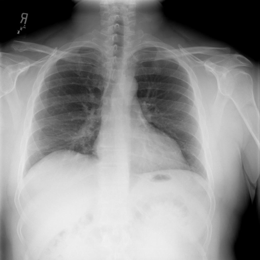
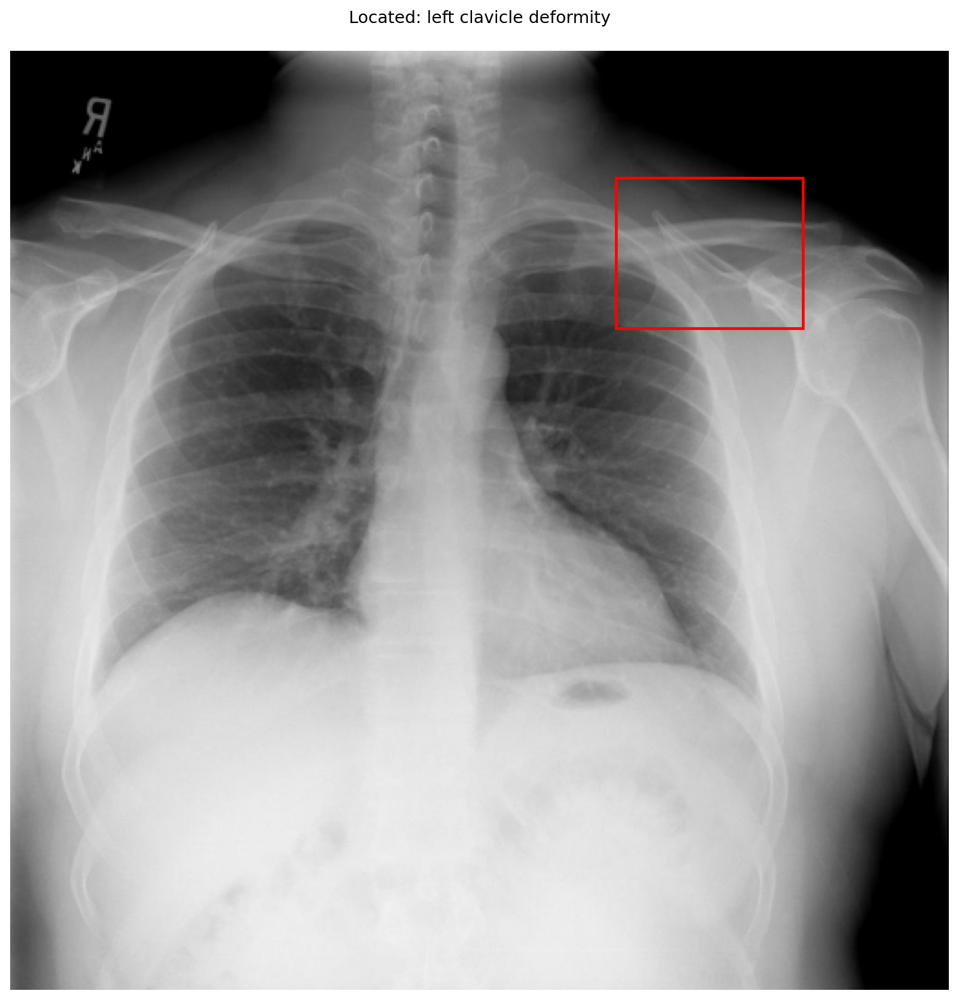

# chexbench_openi_0069
Ordinal 308; source OpenI; stopped-prefix record.

Which finding is in this chest X-ray?

## Complete options

- **A**: left clavicle deformity
- **B**: right clavicle deformity

## Original images

Explicit answer: **A. left clavicle deformity**; reference: **B**; correct: **False**.

Phrase grounding localized 'left clavicle deformity' to the patient's left clavicle (image right), and visual inspection confirms cortical irregularity consistent with deformity on that side.

[Prediction](../../evidence/chexbench/predictions/M43-IM-GT-S50-CXR6/chexbench_openi_0069.json) · [own post-prediction feedback](../../evidence/chexbench/feedback/chexbench_openi_0069.json) · [exact context and Skill version](../../evidence/chexbench/contexts/chexbench_openi_0069.json) · [all main requests/responses](../../evidence/chexbench/services/calls/R50-AGENT/chexbench_openi_0069)

## Tool requests and observations

- medgemma: status=completed; [selection](../../evidence/chexbench/services/tool_selections/R50-AGENT/chexbench_openi_0069/1.json), [full request/result/stdout/stderr artifacts](../../evidence/chexbench/services/tool_cache/a562d1d6fa02784af514b20f424bc8741fe4ddedcfc316144c612d22631ce3ca).
- chest_xray_expert: status=completed; [selection](../../evidence/chexbench/services/tool_selections/R50-AGENT/chexbench_openi_0069/2.json), [full request/result/stdout/stderr artifacts](../../evidence/chexbench/services/tool_cache/81a12b643a6d1d167947fb1d5641a71a1153b366817350e01e46eda07a3bb78f).
- xray_phrase_grounding: status=completed; [selection](../../evidence/chexbench/services/tool_selections/R50-AGENT/chexbench_openi_0069/3.json), [full request/result/stdout/stderr artifacts](../../evidence/chexbench/services/tool_cache/98d297b9788a7ed5814983cea9095a1761f501dfc497c56a59df9b005d6530ad).

## Skill and prior-image provenance

Selected IDs: []; prior same-image IDs: [].

This is dataset-label scoring and model/tool narrative, not clinical adjudication or Skill causal verification.
