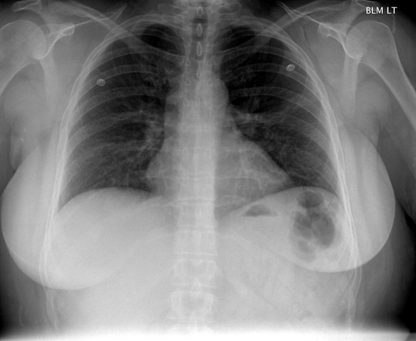
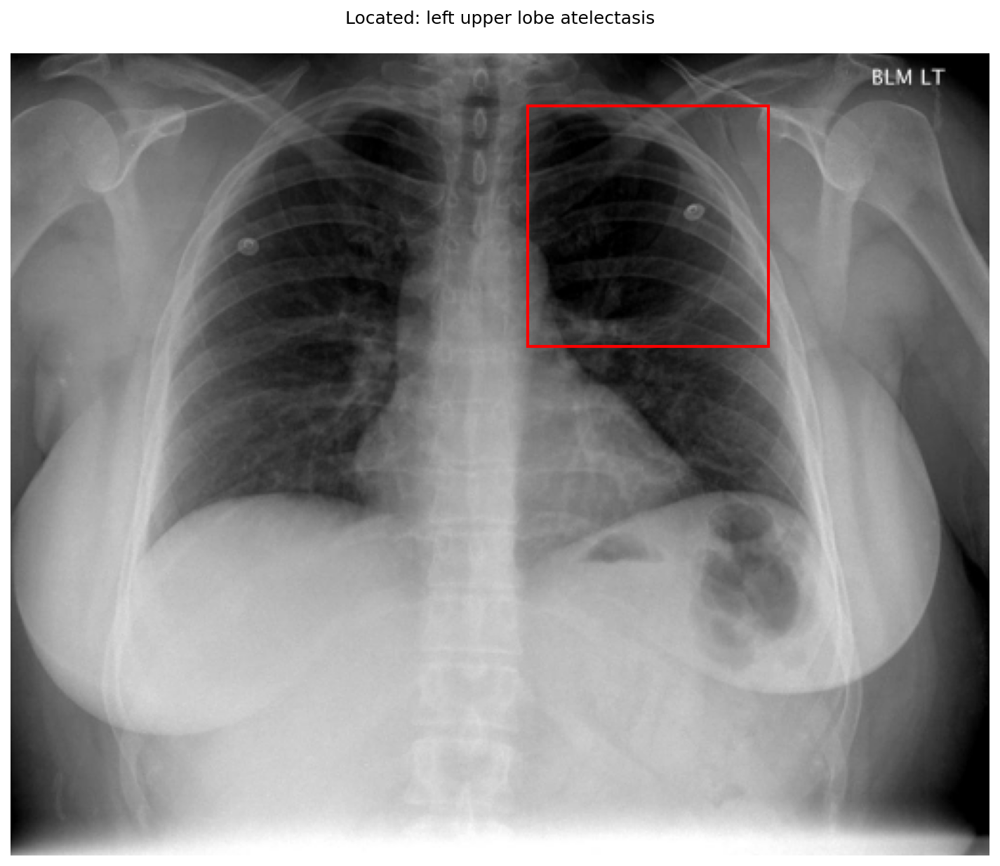
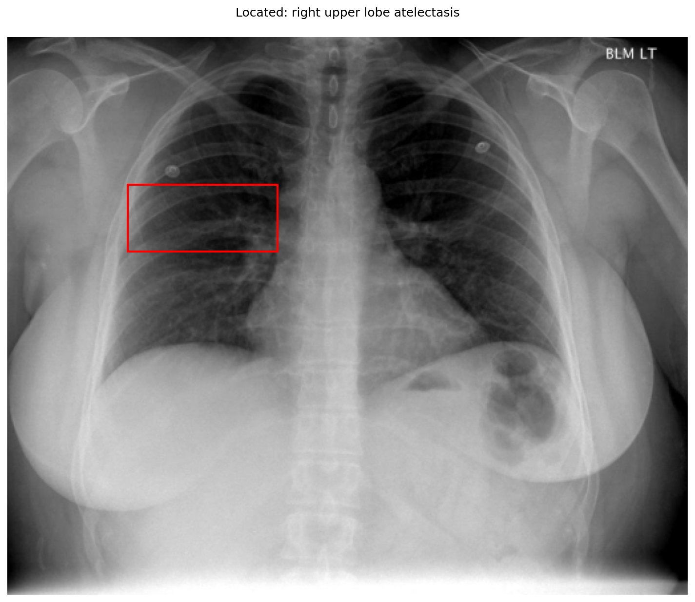

# chexbench_openi_0070
Ordinal 309; source OpenI; stopped-prefix record.

Which finding is in this chest X-ray?

## Complete options

- **A**: left upper lobe pulmonary atelectasis
- **B**: right upper lobe pulmonary atelectasis

## Original images

Explicit answer: **A. left upper lobe pulmonary atelectasis**; reference: **A**; correct: **True**.

The grounding model localized the finding to the left upper zone (image coordinates [0.527, 0.064, 0.773, 0.364]), which corresponds to the patient's left lung on this PA chest X-ray.

[Prediction](../../evidence/chexbench/predictions/M43-IM-GT-S50-CXR6/chexbench_openi_0070.json) · [own post-prediction feedback](../../evidence/chexbench/feedback/chexbench_openi_0070.json) · [exact context and Skill version](../../evidence/chexbench/contexts/chexbench_openi_0070.json) · [all main requests/responses](../../evidence/chexbench/services/calls/R50-AGENT/chexbench_openi_0070)

## Tool requests and observations

- medgemma: status=completed; [selection](../../evidence/chexbench/services/tool_selections/R50-AGENT/chexbench_openi_0070/1.json), [full request/result/stdout/stderr artifacts](../../evidence/chexbench/services/tool_cache/21047e9d4fc0bdbc855ebe366fbb26706c4d1377dc1028dd087b5843e22dde92).
- llava_rad: status=completed; [selection](../../evidence/chexbench/services/tool_selections/R50-AGENT/chexbench_openi_0070/2.json), [full request/result/stdout/stderr artifacts](../../evidence/chexbench/services/tool_cache/662e3668afbd24916ecdeec626d796d74d1a8dad5c06901bd6b3389912d10ca9).
- chest_xray_expert: status=completed; [selection](../../evidence/chexbench/services/tool_selections/R50-AGENT/chexbench_openi_0070/3.json), [full request/result/stdout/stderr artifacts](../../evidence/chexbench/services/tool_cache/6874da93dd2c5baad08efc7352bb1cb32d12c3068a37cf20617b20a39457cd0a).
- xray_phrase_grounding: status=completed; [selection](../../evidence/chexbench/services/tool_selections/R50-AGENT/chexbench_openi_0070/4.json), [full request/result/stdout/stderr artifacts](../../evidence/chexbench/services/tool_cache/099bc7f4de728da9d8f30f5672195573127bc4ad99097c8f09a6ecc9c09af831).

- xray_phrase_grounding: status=completed; [selection](../../evidence/chexbench/services/tool_selections/R50-AGENT/chexbench_openi_0070/5.json), [full request/result/stdout/stderr artifacts](../../evidence/chexbench/services/tool_cache/65e60fc9eb75b1cdb8012e50ec112c773aaad1305821d3c367730da0a4d64190).

## Skill and prior-image provenance

Selected IDs: []; prior same-image IDs: [].

This is dataset-label scoring and model/tool narrative, not clinical adjudication or Skill causal verification.
