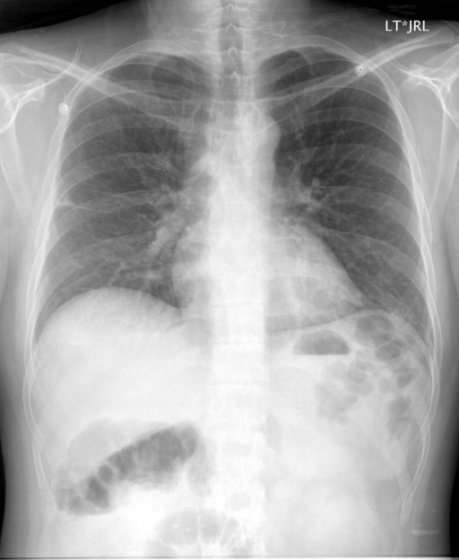
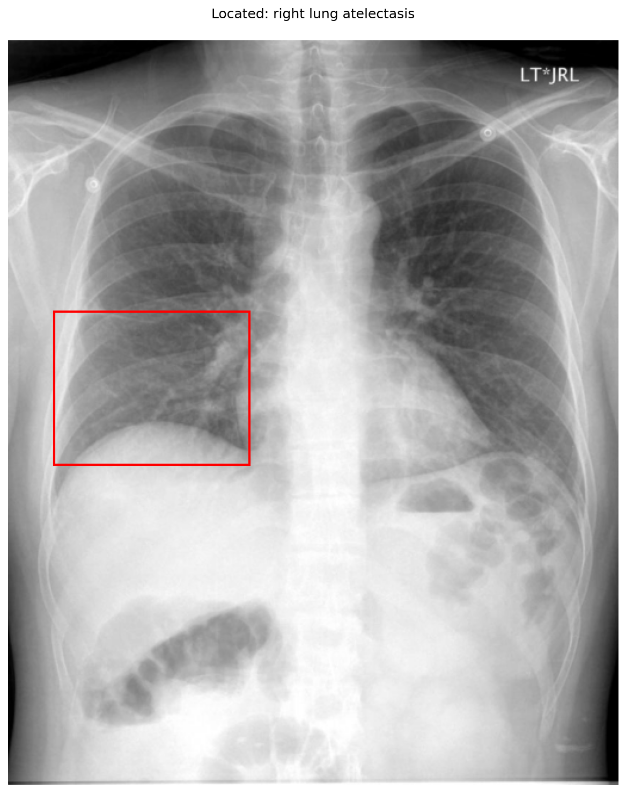

# chexbench_openi_0071
Ordinal 310; source OpenI; stopped-prefix record.

Which finding is in this chest X-ray?

## Complete options

- **A**: pulmonary atelectasis in the right lung
- **B**: pulmonary atelectasis in the left lung

## Original images

Explicit answer: **A. pulmonary atelectasis in the right lung**; reference: **A**; correct: **True**.

Phrase grounding localized right lung atelectasis to the right mid-lung zone, consistent with increased opacity and volume loss on that side.

[Prediction](../../evidence/chexbench/predictions/M43-IM-GT-S50-CXR6/chexbench_openi_0071.json) · [own post-prediction feedback](../../evidence/chexbench/feedback/chexbench_openi_0071.json) · [exact context and Skill version](../../evidence/chexbench/contexts/chexbench_openi_0071.json) · [all main requests/responses](../../evidence/chexbench/services/calls/R50-AGENT/chexbench_openi_0071)

## Tool requests and observations

- medgemma: status=completed; [selection](../../evidence/chexbench/services/tool_selections/R50-AGENT/chexbench_openi_0071/1.json), [full request/result/stdout/stderr artifacts](../../evidence/chexbench/services/tool_cache/f8ed0ae3f90ce602bd636c0273ab64d8a4b08242f71bd77b65d017dfd276eac3).
- chest_xray_expert: status=completed; [selection](../../evidence/chexbench/services/tool_selections/R50-AGENT/chexbench_openi_0071/2.json), [full request/result/stdout/stderr artifacts](../../evidence/chexbench/services/tool_cache/a6220d3fdb2ab2523fe26f10145681fc58dc003dcbd314d3590dedd0fc0c281f).
- xray_phrase_grounding: status=completed; [selection](../../evidence/chexbench/services/tool_selections/R50-AGENT/chexbench_openi_0071/3.json), [full request/result/stdout/stderr artifacts](../../evidence/chexbench/services/tool_cache/8e40c68345147e28112c1710ced978bdf0a0dc3c190105d0ae2aed1b9383786f).

## Skill and prior-image provenance

Selected IDs: []; prior same-image IDs: [].

This is dataset-label scoring and model/tool narrative, not clinical adjudication or Skill causal verification.
