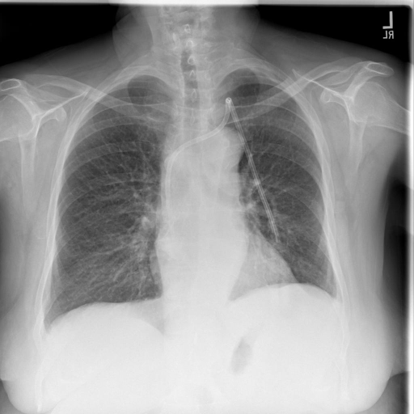
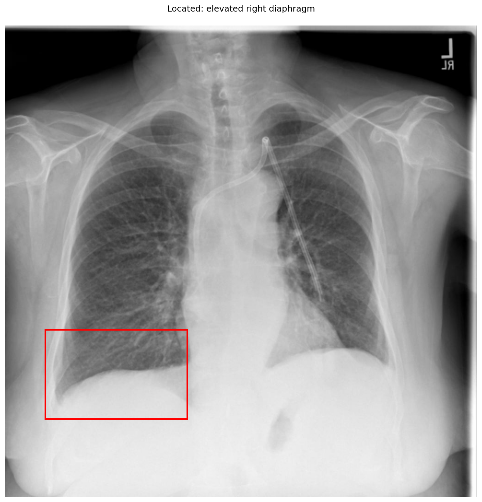
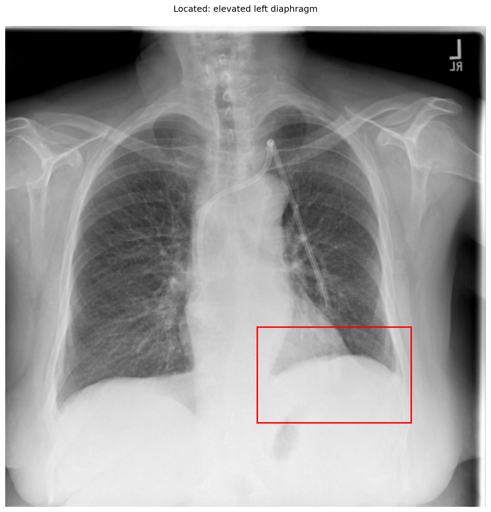

# chexbench_openi_0072
Ordinal 311; source OpenI; stopped-prefix record.

Which finding is in this chest X-ray?

## Complete options

- **A**: elevated right diaphragm
- **B**: elevated left diaphragm

## Original images

Explicit answer: **B. elevated left diaphragm**; reference: **B**; correct: **True**.

Visual inspection confirms the left hemidiaphragm dome is positioned higher than the right, consistent with elevation.

[Prediction](../../evidence/chexbench/predictions/M43-IM-GT-S50-CXR6/chexbench_openi_0072.json) · [own post-prediction feedback](../../evidence/chexbench/feedback/chexbench_openi_0072.json) · [exact context and Skill version](../../evidence/chexbench/contexts/chexbench_openi_0072.json) · [all main requests/responses](../../evidence/chexbench/services/calls/R50-AGENT/chexbench_openi_0072)

## Tool requests and observations

- xray_phrase_grounding: status=completed; [selection](../../evidence/chexbench/services/tool_selections/R50-AGENT/chexbench_openi_0072/1.json), [full request/result/stdout/stderr artifacts](../../evidence/chexbench/services/tool_cache/7d075b3e7ff3e4a9d66fa40dc55db3822895836819be5a6490d1767a23497797).

- xray_phrase_grounding: status=completed; [selection](../../evidence/chexbench/services/tool_selections/R50-AGENT/chexbench_openi_0072/2.json), [full request/result/stdout/stderr artifacts](../../evidence/chexbench/services/tool_cache/fe55b3b364b64696010673883cf0e3643545f6a35dccadd8d298ceaf1dcabf34).

## Skill and prior-image provenance

Selected IDs: []; prior same-image IDs: [].

This is dataset-label scoring and model/tool narrative, not clinical adjudication or Skill causal verification.
