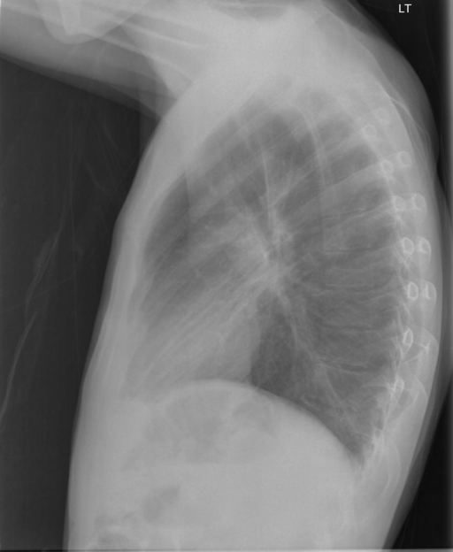
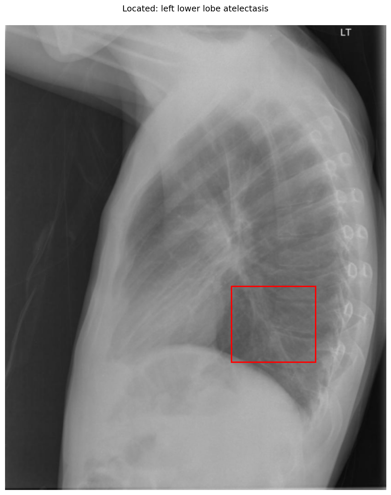

# chexbench_openi_0073
Ordinal 312; source OpenI; stopped-prefix record.

Which finding is in this chest X-ray?

## Complete options

- **A**: right lower lobe pulmonary atelectasis
- **B**: left lower lobe pulmonary atelectasis

## Original images

Explicit answer: **B. left lower lobe pulmonary atelectasis**; reference: **B**; correct: **True**.

Phrase grounding localized left lower lobe atelectasis in the posterior basal region on the lateral view, while right lower lobe grounding returned no finding.

[Prediction](../../evidence/chexbench/predictions/M43-IM-GT-S50-CXR6/chexbench_openi_0073.json) · [own post-prediction feedback](../../evidence/chexbench/feedback/chexbench_openi_0073.json) · [exact context and Skill version](../../evidence/chexbench/contexts/chexbench_openi_0073.json) · [all main requests/responses](../../evidence/chexbench/services/calls/R50-AGENT/chexbench_openi_0073)

## Tool requests and observations

- medgemma: status=completed; [selection](../../evidence/chexbench/services/tool_selections/R50-AGENT/chexbench_openi_0073/1.json), [full request/result/stdout/stderr artifacts](../../evidence/chexbench/services/tool_cache/6ab11ae9e0c1714444f51d4b15f6fae66abe0e13939b4de38db93427500b168d).
- chest_xray_expert: status=completed; [selection](../../evidence/chexbench/services/tool_selections/R50-AGENT/chexbench_openi_0073/2.json), [full request/result/stdout/stderr artifacts](../../evidence/chexbench/services/tool_cache/888e493a408876f2a752b4475381deb3ce60ec67771f27493c95cdc6f5a05c90).
- llava_rad: status=completed; [selection](../../evidence/chexbench/services/tool_selections/R50-AGENT/chexbench_openi_0073/3.json), [full request/result/stdout/stderr artifacts](../../evidence/chexbench/services/tool_cache/6a9f287b1f88599868e4723367925167b4f78eceecffa733d8666673d09d0989).
- xray_phrase_grounding: status=completed; [selection](../../evidence/chexbench/services/tool_selections/R50-AGENT/chexbench_openi_0073/4.json), [full request/result/stdout/stderr artifacts](../../evidence/chexbench/services/tool_cache/08dd5f11aae1c00f7bad006b50550fe8de63803e21a7a811406a410c9d54ca3a).
- xray_phrase_grounding: status=completed; [selection](../../evidence/chexbench/services/tool_selections/R50-AGENT/chexbench_openi_0073/5.json), [full request/result/stdout/stderr artifacts](../../evidence/chexbench/services/tool_cache/13fe00c541b990d062bf359a93d3fa1db023d5eb36977014fd8d0de95efbbb47).

## Skill and prior-image provenance

Selected IDs: []; prior same-image IDs: [].

This is dataset-label scoring and model/tool narrative, not clinical adjudication or Skill causal verification.
