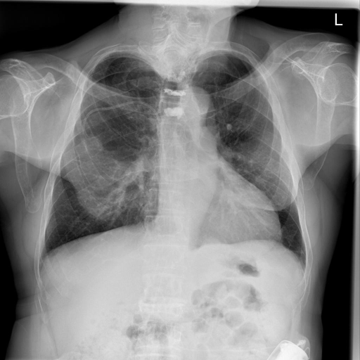
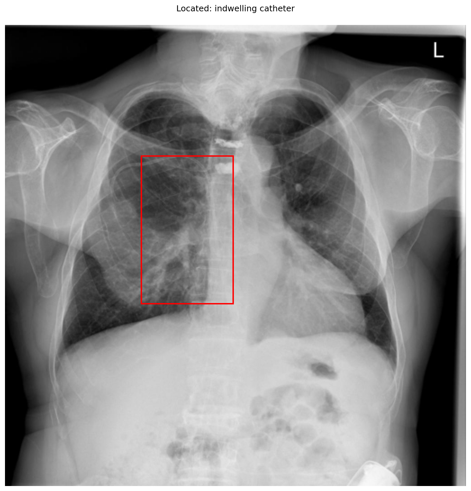

# chexbench_openi_0074
Ordinal 313; source OpenI; stopped-prefix record.

Which finding is in this chest X-ray?

## Complete options

- **A**: left indwelling catheter
- **B**: right indwelling catheter

## Original images

Explicit answer: **A. left indwelling catheter**; reference: **B**; correct: **False**.

The grounding box highlights a catheter-like line in the right hemithorax (patient's left side, confirmed by the 'L' marker), consistent with a left indwelling catheter.

[Prediction](../../evidence/chexbench/predictions/M43-IM-GT-S50-CXR6/chexbench_openi_0074.json) · [own post-prediction feedback](../../evidence/chexbench/feedback/chexbench_openi_0074.json) · [exact context and Skill version](../../evidence/chexbench/contexts/chexbench_openi_0074.json) · [all main requests/responses](../../evidence/chexbench/services/calls/R50-AGENT/chexbench_openi_0074)

## Tool requests and observations

- xray_phrase_grounding: status=completed; [selection](../../evidence/chexbench/services/tool_selections/R50-AGENT/chexbench_openi_0074/1.json), [full request/result/stdout/stderr artifacts](../../evidence/chexbench/services/tool_cache/860145812b2d0b101c9acbd09984641eca099f22caec832f008d8a2cd2360455).

## Skill and prior-image provenance

Selected IDs: []; prior same-image IDs: [].

This is dataset-label scoring and model/tool narrative, not clinical adjudication or Skill causal verification.
