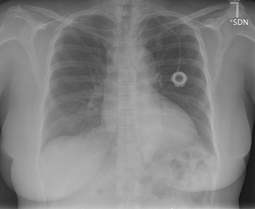
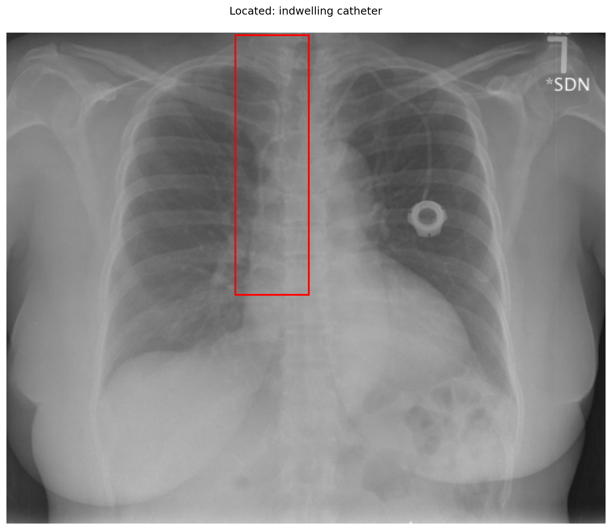

# chexbench_openi_0075
Ordinal 314; source OpenI; stopped-prefix record.

Which finding is in this chest X-ray?

## Complete options

- **A**: left indwelling catheter
- **B**: right indwelling catheter

## Original images

Explicit answer: **B. right indwelling catheter**; reference: **A**; correct: **False**.

The visible port-a-cath device is located in the left upper chest (patient's left), which corresponds to a right-sided indwelling catheter on standard radiographic orientation.

[Prediction](../../evidence/chexbench/predictions/M43-IM-GT-S50-CXR6/chexbench_openi_0075.json) · [own post-prediction feedback](../../evidence/chexbench/feedback/chexbench_openi_0075.json) · [exact context and Skill version](../../evidence/chexbench/contexts/chexbench_openi_0075.json) · [all main requests/responses](../../evidence/chexbench/services/calls/R50-AGENT/chexbench_openi_0075)

## Tool requests and observations

- xray_phrase_grounding: status=completed; [selection](../../evidence/chexbench/services/tool_selections/R50-AGENT/chexbench_openi_0075/1.json), [full request/result/stdout/stderr artifacts](../../evidence/chexbench/services/tool_cache/6a65f5e7d9dcfeca86498e3e84fe00d290590694e2be599cc5c6058443390dea).

## Skill and prior-image provenance

Selected IDs: []; prior same-image IDs: [].

This is dataset-label scoring and model/tool narrative, not clinical adjudication or Skill causal verification.
