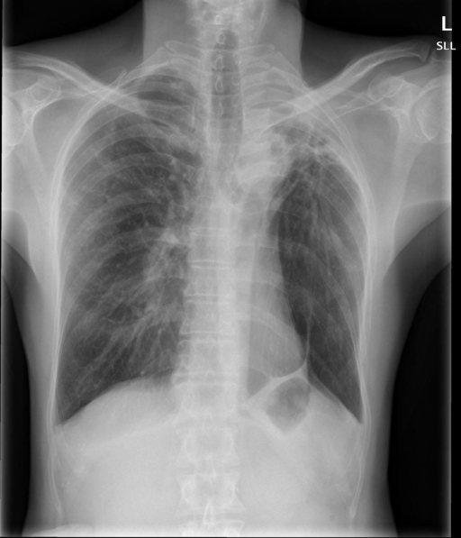

# chexbench_openi_0076
Ordinal 315; source OpenI; stopped-prefix record.

Which finding is in this chest X-ray?

## Complete options

- **A**: left upper lobe pulmonary atelectasis
- **B**: right upper lobe pulmonary atelectasis

## Original images

Explicit answer: **A. left upper lobe pulmonary atelectasis**; reference: **A**; correct: **True**.

Both medgemma and chest_xray_expert identify opacity and volume loss in the left upper zone, consistent with left upper lobe atelectasis.

[Prediction](../../evidence/chexbench/predictions/M43-IM-GT-S50-CXR6/chexbench_openi_0076.json) · [own post-prediction feedback](../../evidence/chexbench/feedback/chexbench_openi_0076.json) · [exact context and Skill version](../../evidence/chexbench/contexts/chexbench_openi_0076.json) · [all main requests/responses](../../evidence/chexbench/services/calls/R50-AGENT/chexbench_openi_0076)

## Tool requests and observations

- medgemma: status=completed; [selection](../../evidence/chexbench/services/tool_selections/R50-AGENT/chexbench_openi_0076/1.json), [full request/result/stdout/stderr artifacts](../../evidence/chexbench/services/tool_cache/c63dbe0157e6b7be9effeba3cdaad5bf07e5f01c6389771cd520f9a23a8bfba9).
- chest_xray_expert: status=completed; [selection](../../evidence/chexbench/services/tool_selections/R50-AGENT/chexbench_openi_0076/2.json), [full request/result/stdout/stderr artifacts](../../evidence/chexbench/services/tool_cache/76f94e0f24284ec9cb3ec020657a7f5aa3a7457933c15f0162cad13b581b2b7f).

## Skill and prior-image provenance

Selected IDs: []; prior same-image IDs: [].

This is dataset-label scoring and model/tool narrative, not clinical adjudication or Skill causal verification.
