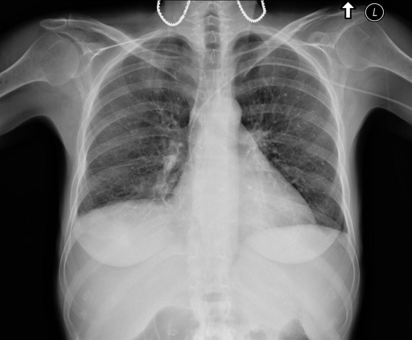

# chexbench_openi_0077
Ordinal 316; source OpenI; stopped-prefix record.

Which finding is in this chest X-ray?

## Complete options

- **A**: right indwelling catheter
- **B**: left indwelling catheter

## Original images

Explicit answer: **B. left indwelling catheter**; reference: **B**; correct: **True**.

The chest_xray_expert model identified a left-sided indwelling catheter, and visual inspection confirms a linear radiopaque density consistent with a catheter on the patient's left side.

[Prediction](../../evidence/chexbench/predictions/M43-IM-GT-S50-CXR6/chexbench_openi_0077.json) · [own post-prediction feedback](../../evidence/chexbench/feedback/chexbench_openi_0077.json) · [exact context and Skill version](../../evidence/chexbench/contexts/chexbench_openi_0077.json) · [all main requests/responses](../../evidence/chexbench/services/calls/R50-AGENT/chexbench_openi_0077)

## Tool requests and observations

- xray_phrase_grounding: status=completed; [selection](../../evidence/chexbench/services/tool_selections/R50-AGENT/chexbench_openi_0077/1.json), [full request/result/stdout/stderr artifacts](../../evidence/chexbench/services/tool_cache/e86c872647d66418725d550049bf158f9ed5cbc012a7af7cbb118b60a8d8c8fb).
- chest_xray_expert: status=completed; [selection](../../evidence/chexbench/services/tool_selections/R50-AGENT/chexbench_openi_0077/2.json), [full request/result/stdout/stderr artifacts](../../evidence/chexbench/services/tool_cache/42d8b5b603d92836d4e756f75177551f743b3127d216315e6fc1be657ac0abfe).

## Skill and prior-image provenance

Selected IDs: []; prior same-image IDs: [].

This is dataset-label scoring and model/tool narrative, not clinical adjudication or Skill causal verification.
