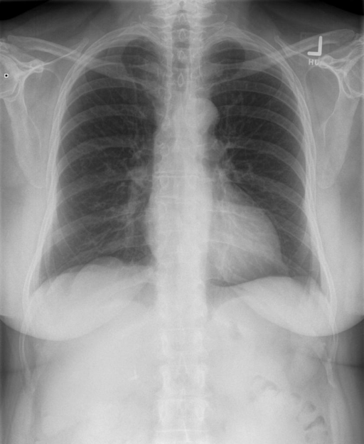

# chexbench_openi_0078
Ordinal 317; source OpenI; stopped-prefix record.

Which finding is in this chest X-ray?

## Complete options

- **A**: surgical instruments in the left abdomen
- **B**: surgical instruments in the right abdomen

## Original images

Explicit answer: **B. surgical instruments in the right abdomen**; reference: **B**; correct: **True**.

The chest_xray_expert tool identified surgical instruments or clips on the right side of the abdomen.

[Prediction](../../evidence/chexbench/predictions/M43-IM-GT-S50-CXR6/chexbench_openi_0078.json) · [own post-prediction feedback](../../evidence/chexbench/feedback/chexbench_openi_0078.json) · [exact context and Skill version](../../evidence/chexbench/contexts/chexbench_openi_0078.json) · [all main requests/responses](../../evidence/chexbench/services/calls/R50-AGENT/chexbench_openi_0078)

## Tool requests and observations

- xray_phrase_grounding: status=failed; [selection](../../evidence/chexbench/services/tool_selections/R50-AGENT/chexbench_openi_0078/1.json), [full request/result/stdout/stderr artifacts](../../evidence/chexbench/services/tool_cache/65e65ea9f529a7ce811f54147a7c2326bf115aeaf0ddb2960ff9c3437d77626d).
- chest_xray_expert: status=completed; [selection](../../evidence/chexbench/services/tool_selections/R50-AGENT/chexbench_openi_0078/2.json), [full request/result/stdout/stderr artifacts](../../evidence/chexbench/services/tool_cache/df447ea49fb62a921788fa42bdcaa7e8c17ea74e2260e5fe71d0382e4323ca44).

## Skill and prior-image provenance

Selected IDs: []; prior same-image IDs: [].

This is dataset-label scoring and model/tool narrative, not clinical adjudication or Skill causal verification.
