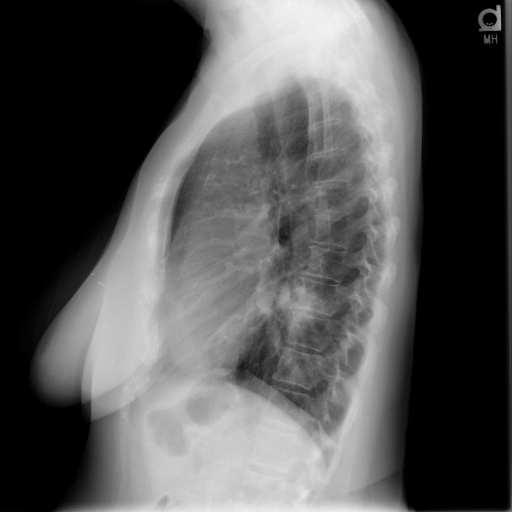
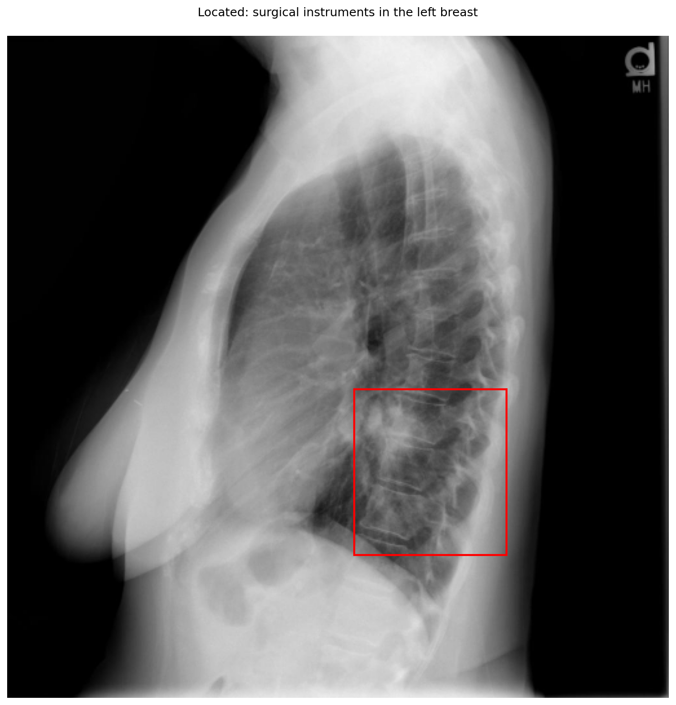
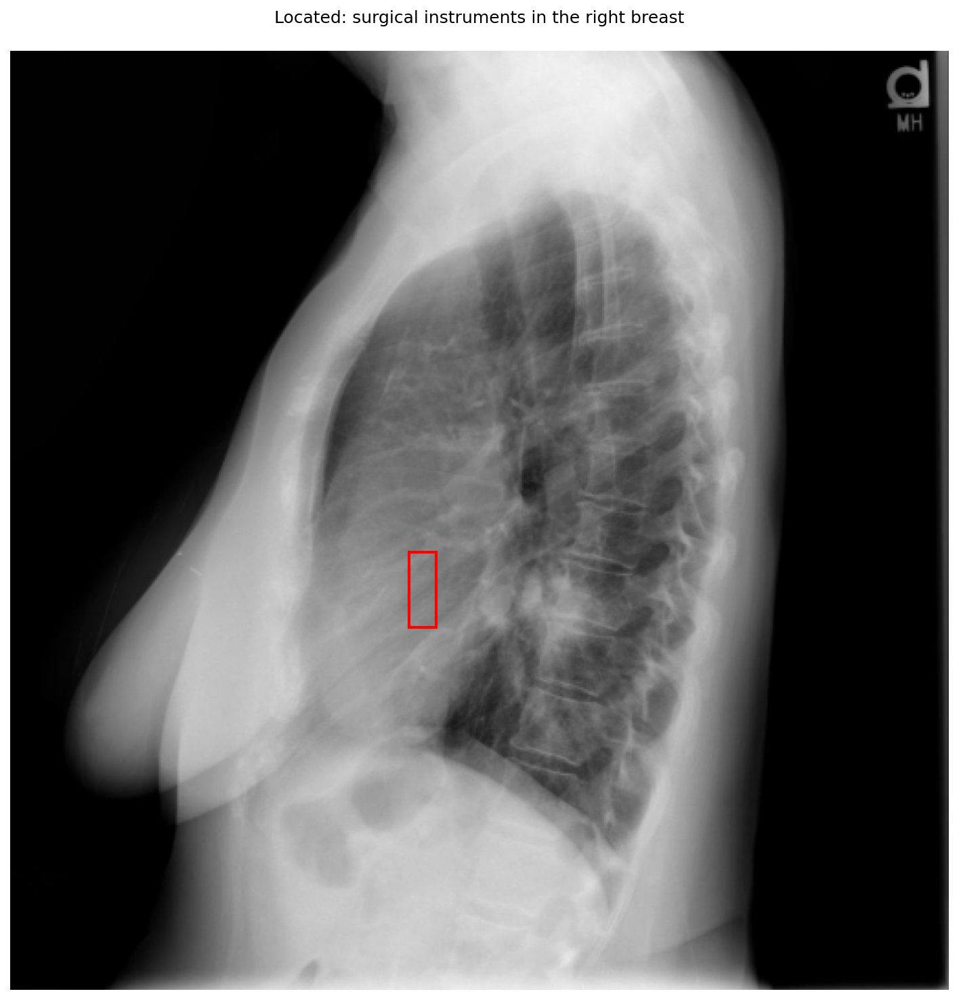

# chexbench_openi_0079
Ordinal 318; source OpenI; stopped-prefix record.

Which finding is in this chest X-ray?

## Complete options

- **A**: surgical instruments in the left breast
- **B**: surgical instruments in the right breast

## Original images

Explicit answer: **A. surgical instruments in the left breast**; reference: **B**; correct: **False**.

The lateral chest X-ray shows a prominent breast shadow on the anterior (left) side of the image with visible linear radiopaque densities consistent with surgical clips or instruments, while the grounding for 'right breast' targeted an empty intrathoracic area.

[Prediction](../../evidence/chexbench/predictions/M43-IM-GT-S50-CXR6/chexbench_openi_0079.json) · [own post-prediction feedback](../../evidence/chexbench/feedback/chexbench_openi_0079.json) · [exact context and Skill version](../../evidence/chexbench/contexts/chexbench_openi_0079.json) · [all main requests/responses](../../evidence/chexbench/services/calls/R50-AGENT/chexbench_openi_0079)

## Tool requests and observations

- xray_phrase_grounding: status=completed; [selection](../../evidence/chexbench/services/tool_selections/R50-AGENT/chexbench_openi_0079/1.json), [full request/result/stdout/stderr artifacts](../../evidence/chexbench/services/tool_cache/5151ca75f73d88c54e0a522c3a595ae96b820df1c77e3ab685270b2b32921e0c).

- xray_phrase_grounding: status=completed; [selection](../../evidence/chexbench/services/tool_selections/R50-AGENT/chexbench_openi_0079/2.json), [full request/result/stdout/stderr artifacts](../../evidence/chexbench/services/tool_cache/c3d575861098213dbfdc26855f284f43c232d4fa84c9c6e20231098bb15e914d).

## Skill and prior-image provenance

Selected IDs: []; prior same-image IDs: [].

This is dataset-label scoring and model/tool narrative, not clinical adjudication or Skill causal verification.
