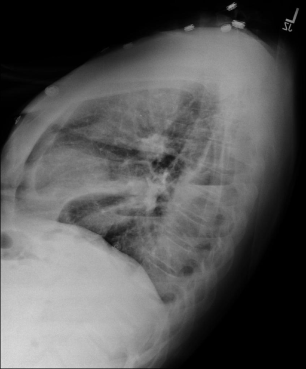
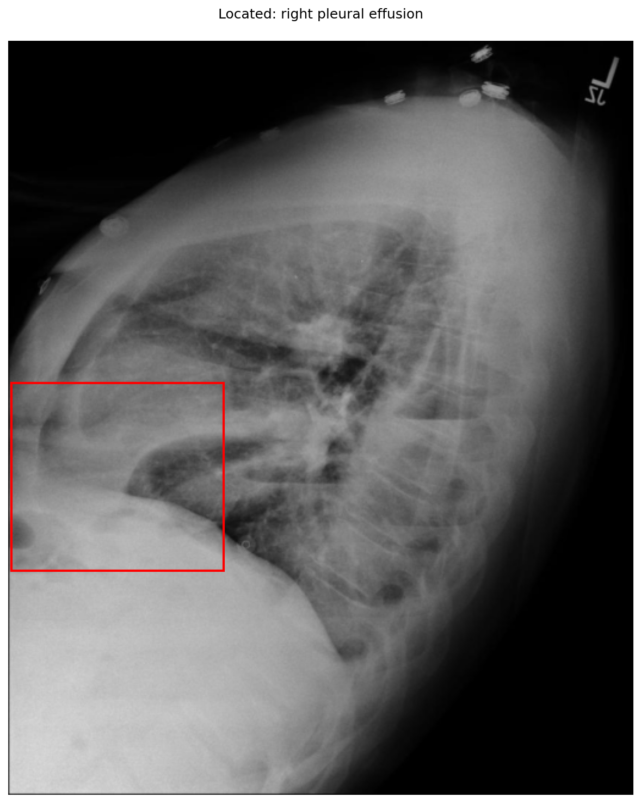

# chexbench_openi_0080
Ordinal 319; source OpenI; stopped-prefix record.

Which finding is in this chest X-ray?

## Complete options

- **A**: left pleural effusion
- **B**: right pleural effusion

## Original images

Explicit answer: **B. right pleural effusion**; reference: **B**; correct: **True**.

The chest_xray_expert identified a right pleural effusion, and xray_phrase_grounding visually localized opacity consistent with fluid in the dependent posterior costophrenic region on this lateral view.

[Prediction](../../evidence/chexbench/predictions/M43-IM-GT-S50-CXR6/chexbench_openi_0080.json) · [own post-prediction feedback](../../evidence/chexbench/feedback/chexbench_openi_0080.json) · [exact context and Skill version](../../evidence/chexbench/contexts/chexbench_openi_0080.json) · [all main requests/responses](../../evidence/chexbench/services/calls/R50-AGENT/chexbench_openi_0080)

## Tool requests and observations

- medgemma: status=completed; [selection](../../evidence/chexbench/services/tool_selections/R50-AGENT/chexbench_openi_0080/1.json), [full request/result/stdout/stderr artifacts](../../evidence/chexbench/services/tool_cache/360dae6329371b84f24eca76de41b51f9b0dc2884f474c39ed285cf99c5827a8).
- chest_xray_expert: status=completed; [selection](../../evidence/chexbench/services/tool_selections/R50-AGENT/chexbench_openi_0080/2.json), [full request/result/stdout/stderr artifacts](../../evidence/chexbench/services/tool_cache/e9ac5830cb17fd0207d726ac859e0d74c5a75320eee2fa0757601d65df08f01e).
- xray_phrase_grounding: status=completed; [selection](../../evidence/chexbench/services/tool_selections/R50-AGENT/chexbench_openi_0080/3.json), [full request/result/stdout/stderr artifacts](../../evidence/chexbench/services/tool_cache/12ff9d4674eadffaa9a2382773b30dfcc4e4ac4211275f16a8c452a36f5e1707).

## Skill and prior-image provenance

Selected IDs: []; prior same-image IDs: [].

This is dataset-label scoring and model/tool narrative, not clinical adjudication or Skill causal verification.
