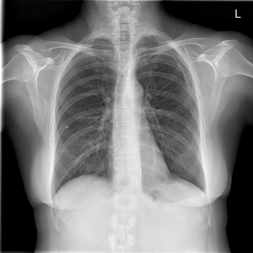
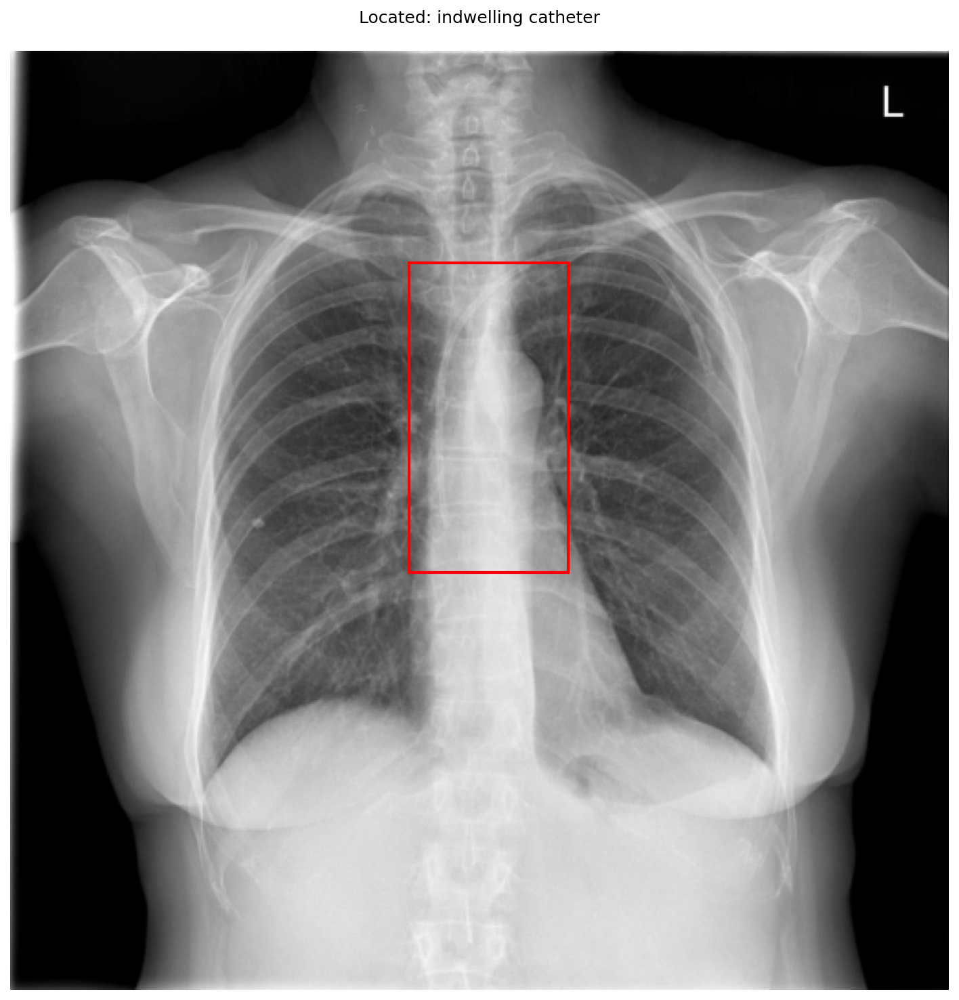

# chexbench_openi_0081
Ordinal 320; source OpenI; stopped-prefix record.

Which finding is in this chest X-ray?

## Complete options

- **A**: left indwelling catheter
- **B**: right indwelling catheter

## Original images

Explicit answer: **A. left indwelling catheter**; reference: **A**; correct: **True**.

Two independent VLM tools (chest_xray_expert and llava_rad) both identified a left-sided indwelling catheter, corroborating the finding despite the grounding tool's central bounding box.

[Prediction](../../evidence/chexbench/predictions/M43-IM-GT-S50-CXR6/chexbench_openi_0081.json) · [own post-prediction feedback](../../evidence/chexbench/feedback/chexbench_openi_0081.json) · [exact context and Skill version](../../evidence/chexbench/contexts/chexbench_openi_0081.json) · [all main requests/responses](../../evidence/chexbench/services/calls/R50-AGENT/chexbench_openi_0081)

## Tool requests and observations

- xray_phrase_grounding: status=completed; [selection](../../evidence/chexbench/services/tool_selections/R50-AGENT/chexbench_openi_0081/1.json), [full request/result/stdout/stderr artifacts](../../evidence/chexbench/services/tool_cache/a06eff793c549b2317a388bd121b94ca2c4b60e44cd30ff8f1127adf55e05e0f).

- chest_xray_expert: status=completed; [selection](../../evidence/chexbench/services/tool_selections/R50-AGENT/chexbench_openi_0081/2.json), [full request/result/stdout/stderr artifacts](../../evidence/chexbench/services/tool_cache/c593737ec094b64fe99da1138e4bf81b64ef38e4320372af5ed08961b7b43e0e).
- llava_rad: status=completed; [selection](../../evidence/chexbench/services/tool_selections/R50-AGENT/chexbench_openi_0081/3.json), [full request/result/stdout/stderr artifacts](../../evidence/chexbench/services/tool_cache/12d17a4909596d81ead11b1860478baed81c9aedbc90cb5eaad5bd787aad0533).

## Skill and prior-image provenance

Selected IDs: []; prior same-image IDs: [].

This is dataset-label scoring and model/tool narrative, not clinical adjudication or Skill causal verification.
