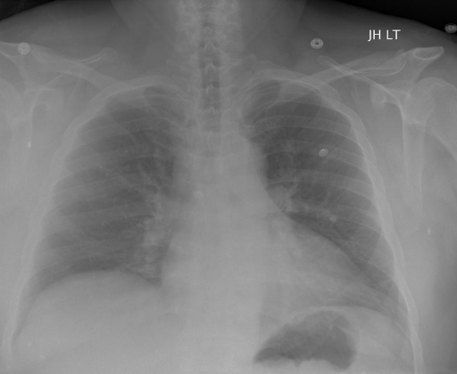
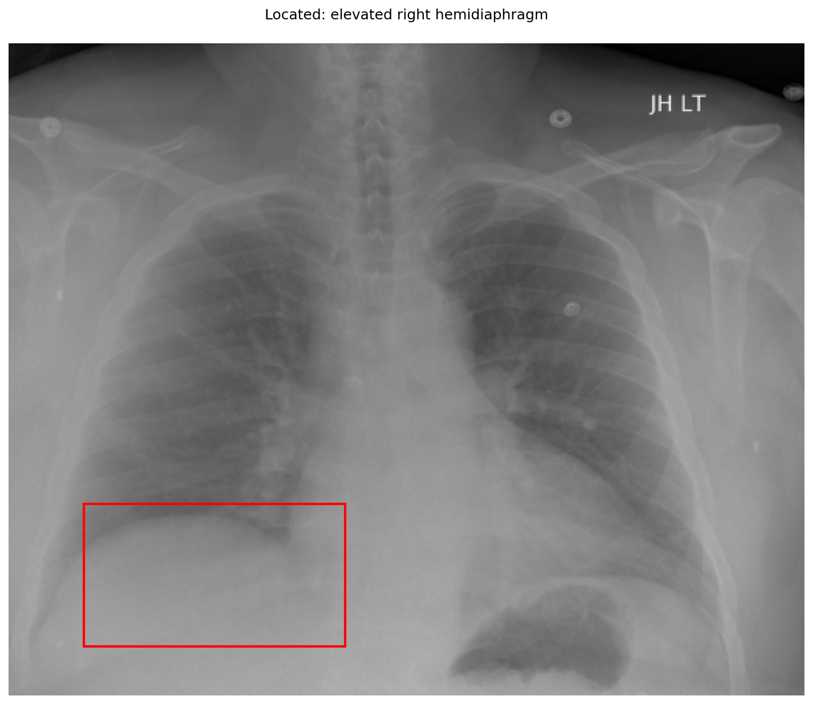

# chexbench_openi_0082
Ordinal 321; source OpenI; stopped-prefix record.

Which finding is in this chest X-ray?

## Complete options

- **A**: elevated right diaphragm
- **B**: elevated left diaphragm

## Original images

Explicit answer: **A. elevated right diaphragm**; reference: **A**; correct: **True**.

The grounding box highlights the right hemidiaphragm, which appears higher than the left side with a visible gastric bubble below it.

[Prediction](../../evidence/chexbench/predictions/M43-IM-GT-S50-CXR6/chexbench_openi_0082.json) · [own post-prediction feedback](../../evidence/chexbench/feedback/chexbench_openi_0082.json) · [exact context and Skill version](../../evidence/chexbench/contexts/chexbench_openi_0082.json) · [all main requests/responses](../../evidence/chexbench/services/calls/R50-AGENT/chexbench_openi_0082)

## Tool requests and observations

- medgemma: status=completed; [selection](../../evidence/chexbench/services/tool_selections/R50-AGENT/chexbench_openi_0082/1.json), [full request/result/stdout/stderr artifacts](../../evidence/chexbench/services/tool_cache/a260ea4ed96bd87f14a05a4d09396a3e8f47a9efde4fdd48d98493c82d8e087b).
- xray_phrase_grounding: status=completed; [selection](../../evidence/chexbench/services/tool_selections/R50-AGENT/chexbench_openi_0082/2.json), [full request/result/stdout/stderr artifacts](../../evidence/chexbench/services/tool_cache/506e51815f6246d54bbaed2203375d55adab01f09f6462b214057ac5a98c9f06).

## Skill and prior-image provenance

Selected IDs: []; prior same-image IDs: [].

This is dataset-label scoring and model/tool narrative, not clinical adjudication or Skill causal verification.
