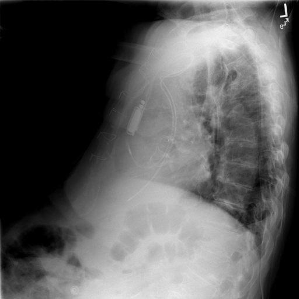
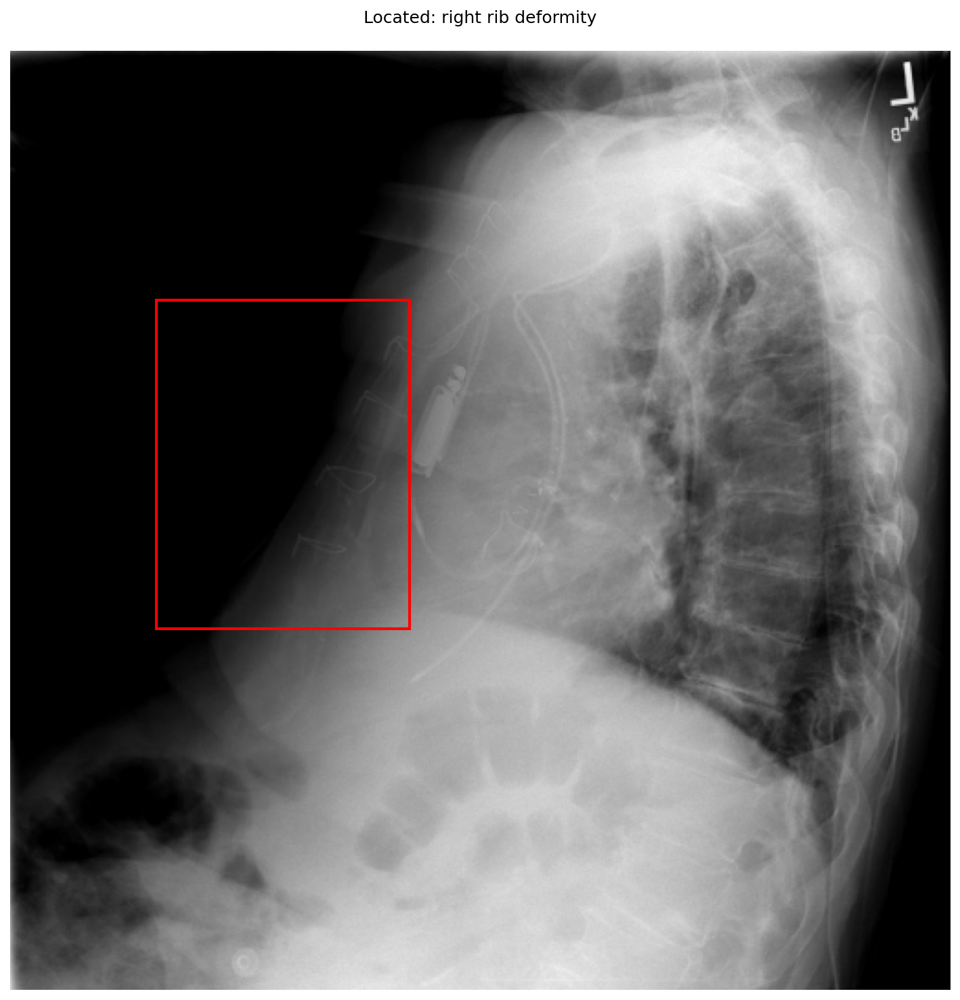

# chexbench_openi_0084
Ordinal 323; source OpenI; stopped-prefix record.

Which finding is in this chest X-ray?

## Complete options

- **A**: left rib deformity
- **B**: right rib deformity

## Original images

Explicit answer: **B. right rib deformity**; reference: **B**; correct: **True**.

Multiple models and phrase grounding consistently identify a right rib deformity, with the grounding box localizing to the anterior chest wall where right ribs are projected in this lateral view.

[Prediction](../../evidence/chexbench/predictions/M43-IM-GT-S50-CXR6/chexbench_openi_0084.json) · [own post-prediction feedback](../../evidence/chexbench/feedback/chexbench_openi_0084.json) · [exact context and Skill version](../../evidence/chexbench/contexts/chexbench_openi_0084.json) · [all main requests/responses](../../evidence/chexbench/services/calls/R50-AGENT/chexbench_openi_0084)

## Tool requests and observations

- medgemma: status=completed; [selection](../../evidence/chexbench/services/tool_selections/R50-AGENT/chexbench_openi_0084/1.json), [full request/result/stdout/stderr artifacts](../../evidence/chexbench/services/tool_cache/3b54c5f249ba7161bd08e81cc76714f28947a59620afab5ccff6e5fece9034e2).
- chest_xray_expert: status=completed; [selection](../../evidence/chexbench/services/tool_selections/R50-AGENT/chexbench_openi_0084/2.json), [full request/result/stdout/stderr artifacts](../../evidence/chexbench/services/tool_cache/e8b8deef08310716da14bfa56c5cc65ca677a034cb61a2fb18842c1db38cfd4e).
- xray_phrase_grounding: status=completed; [selection](../../evidence/chexbench/services/tool_selections/R50-AGENT/chexbench_openi_0084/3.json), [full request/result/stdout/stderr artifacts](../../evidence/chexbench/services/tool_cache/90e3b6a982892c5274f8ea95584cfb0a30da1744f18531b99d6b4ab068f79b3b).

## Skill and prior-image provenance

Selected IDs: []; prior same-image IDs: [].

This is dataset-label scoring and model/tool narrative, not clinical adjudication or Skill causal verification.
