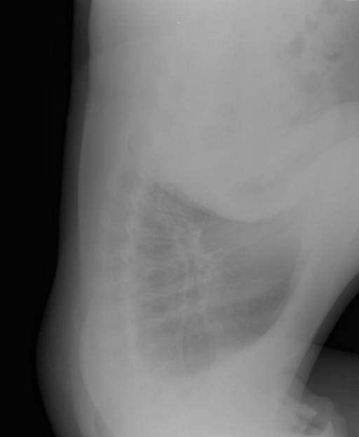

# chexbench_openi_0085
Ordinal 324; source OpenI; stopped-prefix record.

Which finding is in this chest X-ray?

## Complete options

- **A**: left clavicle deformity
- **B**: right clavicle deformity

## Original images

Explicit answer: **A**; reference: **A**; correct: **True**.

The lateral chest X-ray shows a visible deformity and irregularity of the left clavicle, consistent with an old fracture or malunion.

[Prediction](../../evidence/chexbench/predictions/M43-IM-GT-S50-CXR6/chexbench_openi_0085.json) · [own post-prediction feedback](../../evidence/chexbench/feedback/chexbench_openi_0085.json) · [exact context and Skill version](../../evidence/chexbench/contexts/chexbench_openi_0085.json) · [all main requests/responses](../../evidence/chexbench/services/calls/R50-AGENT/chexbench_openi_0085)

## Tool requests and observations

## Skill and prior-image provenance

Selected IDs: []; prior same-image IDs: [].

This is dataset-label scoring and model/tool narrative, not clinical adjudication or Skill causal verification.
