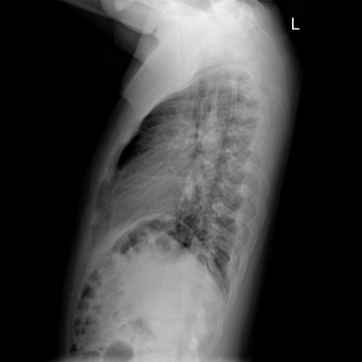

# chexbench_openi_0086
Ordinal 325; source OpenI; stopped-prefix record.

Which finding is in this chest X-ray?

## Complete options

- **A**: left thoracic vertebrae scoliosis
- **B**: right thoracic vertebrae scoliosis

## Original images

Explicit answer: **B. right thoracic vertebrae scoliosis**; reference: **B**; correct: **True**.

Two independent VLMs (medgemma and llava_med_qa) identified right-convex thoracic scoliosis, while chest_xray_expert said left; grounding failed to localize and other models were non-informative, so the majority specific finding supports right.

[Prediction](../../evidence/chexbench/predictions/M43-IM-GT-S50-CXR6/chexbench_openi_0086.json) · [own post-prediction feedback](../../evidence/chexbench/feedback/chexbench_openi_0086.json) · [exact context and Skill version](../../evidence/chexbench/contexts/chexbench_openi_0086.json) · [all main requests/responses](../../evidence/chexbench/services/calls/R50-AGENT/chexbench_openi_0086)

## Tool requests and observations

- medgemma: status=completed; [selection](../../evidence/chexbench/services/tool_selections/R50-AGENT/chexbench_openi_0086/1.json), [full request/result/stdout/stderr artifacts](../../evidence/chexbench/services/tool_cache/1936ef93d7503a74cbf490488cfc788e0c4edda3da2f7d8bbc988479ea584b37).
- chest_xray_expert: status=completed; [selection](../../evidence/chexbench/services/tool_selections/R50-AGENT/chexbench_openi_0086/2.json), [full request/result/stdout/stderr artifacts](../../evidence/chexbench/services/tool_cache/a9458998d02566b9976131fe47dfbcc079ec495b84d8a3e105ba2b8f562664c4).
- llava_med_qa: status=completed; [selection](../../evidence/chexbench/services/tool_selections/R50-AGENT/chexbench_openi_0086/3.json), [full request/result/stdout/stderr artifacts](../../evidence/chexbench/services/tool_cache/d73097816fac7bb44e8d0fdba184cd8f45af94bf79a530a3af8d4fb744724e6b).
- xray_phrase_grounding: status=completed; [selection](../../evidence/chexbench/services/tool_selections/R50-AGENT/chexbench_openi_0086/4.json), [full request/result/stdout/stderr artifacts](../../evidence/chexbench/services/tool_cache/87264447a2a21a6f2ee5270a70ef7eec602813d73ce3bc95d2ab86cf85ad5bdb).
- medvlm_r1: status=completed; [selection](../../evidence/chexbench/services/tool_selections/R50-AGENT/chexbench_openi_0086/5.json), [full request/result/stdout/stderr artifacts](../../evidence/chexbench/services/tool_cache/41d894c314a9ed87c9a8b0650e9601ab56025eec240b455eb64e2767cb4d0310).
- llava_rad: status=completed; [selection](../../evidence/chexbench/services/tool_selections/R50-AGENT/chexbench_openi_0086/6.json), [full request/result/stdout/stderr artifacts](../../evidence/chexbench/services/tool_cache/f23b2ecff7274dfa3a5cde5d3dd2cb0369e862a9be9035ea1758bff834d31c45).

## Skill and prior-image provenance

Selected IDs: []; prior same-image IDs: [].

This is dataset-label scoring and model/tool narrative, not clinical adjudication or Skill causal verification.
