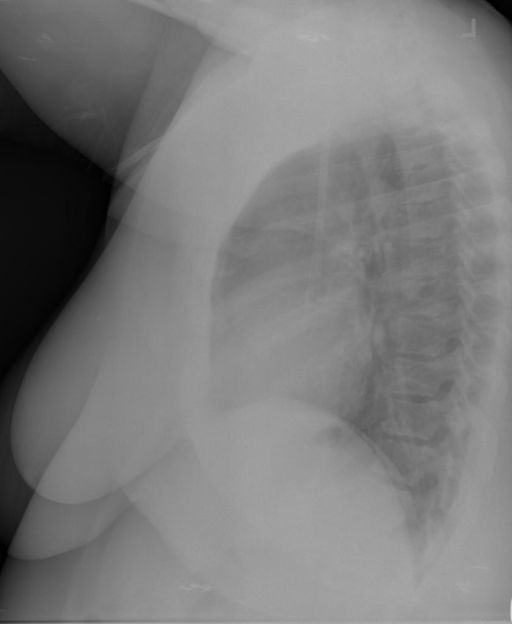

# chexbench_openi_0087
Ordinal 326; source OpenI; stopped-prefix record.

Which finding is in this chest X-ray?

## Complete options

- **A**: left indwelling catheter
- **B**: right indwelling catheter

## Original images

Explicit answer: **B. right indwelling catheter**; reference: **B**; correct: **True**.

Two independent VLMs (chest_xray_expert and llava_rad) identified a right-sided catheter, while grounding tools failed to localize either side; the specific description of a right dual-lumen catheter by llava_rad provides sufficient evidence.

[Prediction](../../evidence/chexbench/predictions/M43-IM-GT-S50-CXR6/chexbench_openi_0087.json) · [own post-prediction feedback](../../evidence/chexbench/feedback/chexbench_openi_0087.json) · [exact context and Skill version](../../evidence/chexbench/contexts/chexbench_openi_0087.json) · [all main requests/responses](../../evidence/chexbench/services/calls/R50-AGENT/chexbench_openi_0087)

## Tool requests and observations

- medgemma: status=completed; [selection](../../evidence/chexbench/services/tool_selections/R50-AGENT/chexbench_openi_0087/1.json), [full request/result/stdout/stderr artifacts](../../evidence/chexbench/services/tool_cache/e550f027e71f9a207e5666fe5fd58c5d9262b55c234542f85415499c21d9759b).
- chest_xray_expert: status=completed; [selection](../../evidence/chexbench/services/tool_selections/R50-AGENT/chexbench_openi_0087/2.json), [full request/result/stdout/stderr artifacts](../../evidence/chexbench/services/tool_cache/d0ac3b1710affdbc9ae9bcfe64ee67c91d8a0e463c442af37bd9a6b7e1ea150c).
- xray_phrase_grounding: status=completed; [selection](../../evidence/chexbench/services/tool_selections/R50-AGENT/chexbench_openi_0087/3.json), [full request/result/stdout/stderr artifacts](../../evidence/chexbench/services/tool_cache/205f2eebd505d4c120aa995b4a8091f22df149111957be64112889b6c5c8fa25).
- xray_phrase_grounding: status=completed; [selection](../../evidence/chexbench/services/tool_selections/R50-AGENT/chexbench_openi_0087/4.json), [full request/result/stdout/stderr artifacts](../../evidence/chexbench/services/tool_cache/603aafc8d330cf6602ef8440d05789682f6c54882c9cdf291cdcd6001953429f).
- llava_rad: status=completed; [selection](../../evidence/chexbench/services/tool_selections/R50-AGENT/chexbench_openi_0087/5.json), [full request/result/stdout/stderr artifacts](../../evidence/chexbench/services/tool_cache/9557dc5969f15935f8bc7555893084788aaa3c1282fa483e4cf523a9e375a75e).

## Skill and prior-image provenance

Selected IDs: []; prior same-image IDs: [].

This is dataset-label scoring and model/tool narrative, not clinical adjudication or Skill causal verification.
