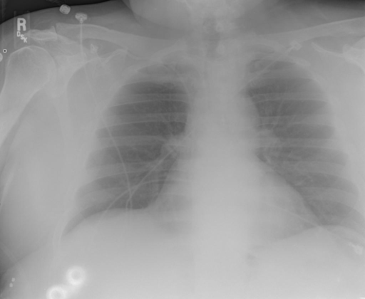
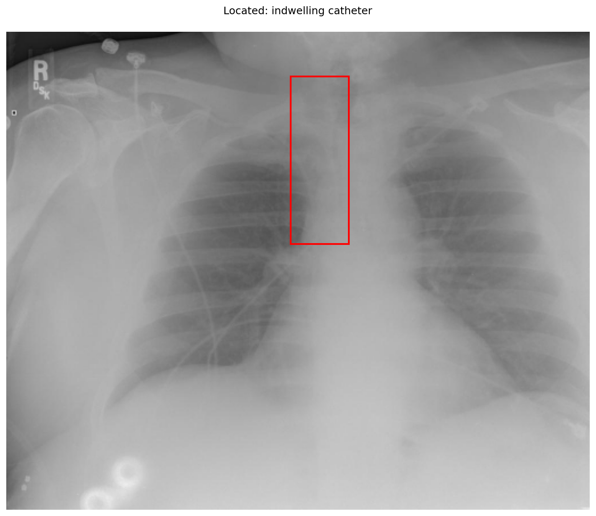

# chexbench_openi_0088
Ordinal 327; source OpenI; stopped-prefix record.

Which finding is in this chest X-ray?

## Complete options

- **A**: right indwelling catheter
- **B**: left indwelling catheter

## Original images

Explicit answer: **A. right indwelling catheter**; reference: **A**; correct: **True**.

The grounding box and independent VLM interpretation both localize the indwelling catheter to the right side of the chest, consistent with the 'R' marker.

[Prediction](../../evidence/chexbench/predictions/M43-IM-GT-S50-CXR6/chexbench_openi_0088.json) · [own post-prediction feedback](../../evidence/chexbench/feedback/chexbench_openi_0088.json) · [exact context and Skill version](../../evidence/chexbench/contexts/chexbench_openi_0088.json) · [all main requests/responses](../../evidence/chexbench/services/calls/R50-AGENT/chexbench_openi_0088)

## Tool requests and observations

- xray_phrase_grounding: status=completed; [selection](../../evidence/chexbench/services/tool_selections/R50-AGENT/chexbench_openi_0088/1.json), [full request/result/stdout/stderr artifacts](../../evidence/chexbench/services/tool_cache/1c5ea3203662d293a3b9ec4ba8a45d11d68eb14dfda8bf2044cb5b5b9d8c9e0a).

- medgemma: status=completed; [selection](../../evidence/chexbench/services/tool_selections/R50-AGENT/chexbench_openi_0088/2.json), [full request/result/stdout/stderr artifacts](../../evidence/chexbench/services/tool_cache/3e31989dfeb1b6ba89d956c102d9e0790cb43526ebcea6091fe6fb63e49f4303).

## Skill and prior-image provenance

Selected IDs: []; prior same-image IDs: [].

This is dataset-label scoring and model/tool narrative, not clinical adjudication or Skill causal verification.
