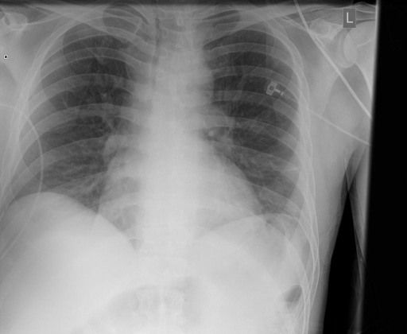
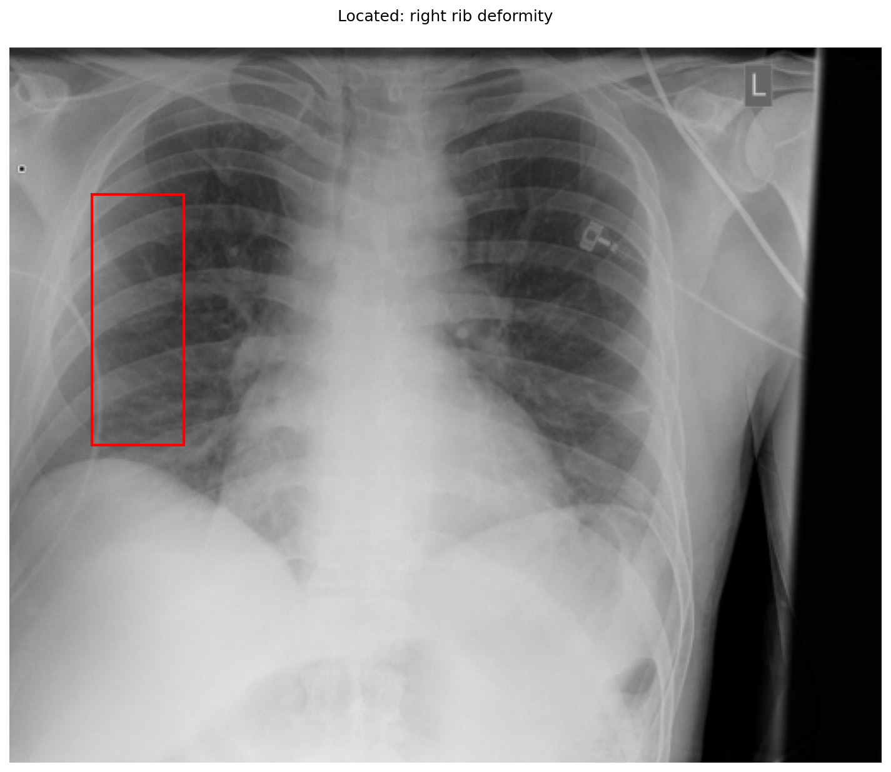
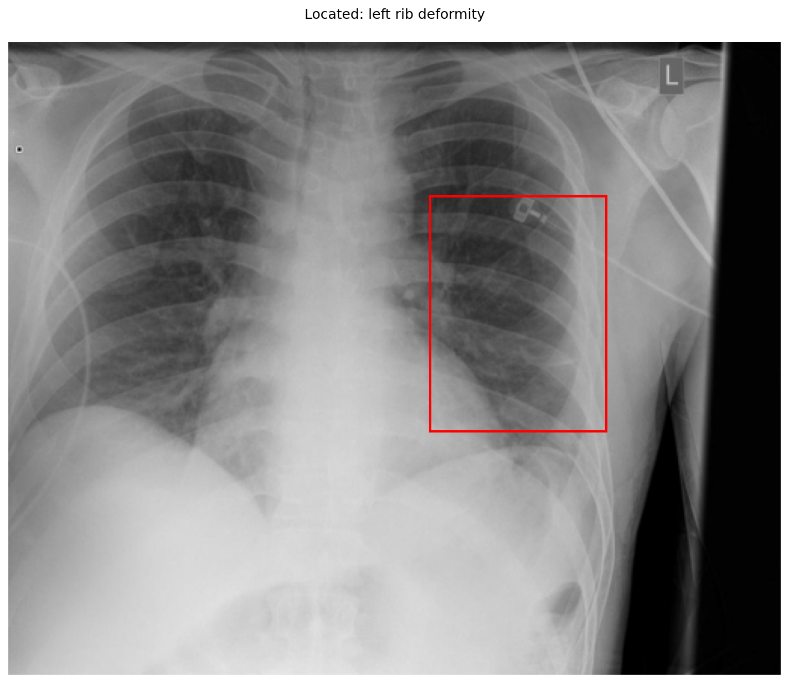

# chexbench_openi_0089
Ordinal 328; source OpenI; stopped-prefix record.

Which finding is in this chest X-ray?

## Complete options

- **A**: right rib deformity
- **B**: left rib deformity

## Original images

Explicit answer: **A. right rib deformity**; reference: **A**; correct: **True**.

The grounding visualization for 'right rib deformity' highlights the lateral right ribs where cortical irregularity is visible, whereas the left-sided box primarily contains an external monitoring device rather than a bony deformity.

[Prediction](../../evidence/chexbench/predictions/M43-IM-GT-S50-CXR6/chexbench_openi_0089.json) · [own post-prediction feedback](../../evidence/chexbench/feedback/chexbench_openi_0089.json) · [exact context and Skill version](../../evidence/chexbench/contexts/chexbench_openi_0089.json) · [all main requests/responses](../../evidence/chexbench/services/calls/R50-AGENT/chexbench_openi_0089)

## Tool requests and observations

- xray_phrase_grounding: status=completed; [selection](../../evidence/chexbench/services/tool_selections/R50-AGENT/chexbench_openi_0089/1.json), [full request/result/stdout/stderr artifacts](../../evidence/chexbench/services/tool_cache/24e5a0bde6e5b80905c737eedb3ce1b360b1d2a5a09278aa32f8f28c79f04c7c).

- xray_phrase_grounding: status=completed; [selection](../../evidence/chexbench/services/tool_selections/R50-AGENT/chexbench_openi_0089/2.json), [full request/result/stdout/stderr artifacts](../../evidence/chexbench/services/tool_cache/9327720ac465112cd08f6f39f7a249b62c60967525784a95dbceb973150d2b39).

## Skill and prior-image provenance

Selected IDs: []; prior same-image IDs: [].

This is dataset-label scoring and model/tool narrative, not clinical adjudication or Skill causal verification.
