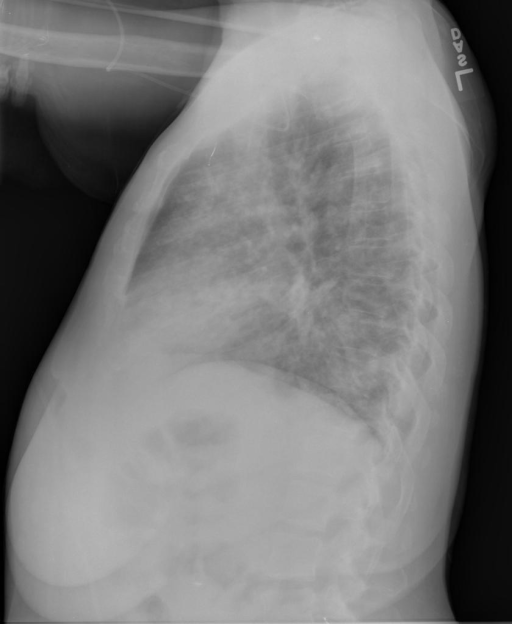

# chexbench_openi_0090
Ordinal 329; source OpenI; stopped-prefix record.

Which finding is in this chest X-ray?

## Complete options

- **A**: right indwelling catheter
- **B**: left indwelling catheter

## Original images

Explicit answer: **A. right indwelling catheter**; reference: **A**; correct: **True**.

The chest_xray_expert model identified a right indwelling catheter in the lateral chest X-ray.

[Prediction](../../evidence/chexbench/predictions/M43-IM-GT-S50-CXR6/chexbench_openi_0090.json) · [own post-prediction feedback](../../evidence/chexbench/feedback/chexbench_openi_0090.json) · [exact context and Skill version](../../evidence/chexbench/contexts/chexbench_openi_0090.json) · [all main requests/responses](../../evidence/chexbench/services/calls/R50-AGENT/chexbench_openi_0090)

## Tool requests and observations

- xray_phrase_grounding: status=completed; [selection](../../evidence/chexbench/services/tool_selections/R50-AGENT/chexbench_openi_0090/1.json), [full request/result/stdout/stderr artifacts](../../evidence/chexbench/services/tool_cache/25232b386f6b68b0a977cbdae1f39a732494661c2384015078529e34f4782b6a).
- chest_xray_expert: status=completed; [selection](../../evidence/chexbench/services/tool_selections/R50-AGENT/chexbench_openi_0090/2.json), [full request/result/stdout/stderr artifacts](../../evidence/chexbench/services/tool_cache/bdc2bd296b3f74e76d024e4985b39e8a1b042d589896f6bd0bcfc9b702d7fda1).

## Skill and prior-image provenance

Selected IDs: []; prior same-image IDs: [].

This is dataset-label scoring and model/tool narrative, not clinical adjudication or Skill causal verification.
