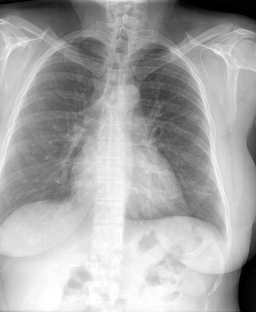
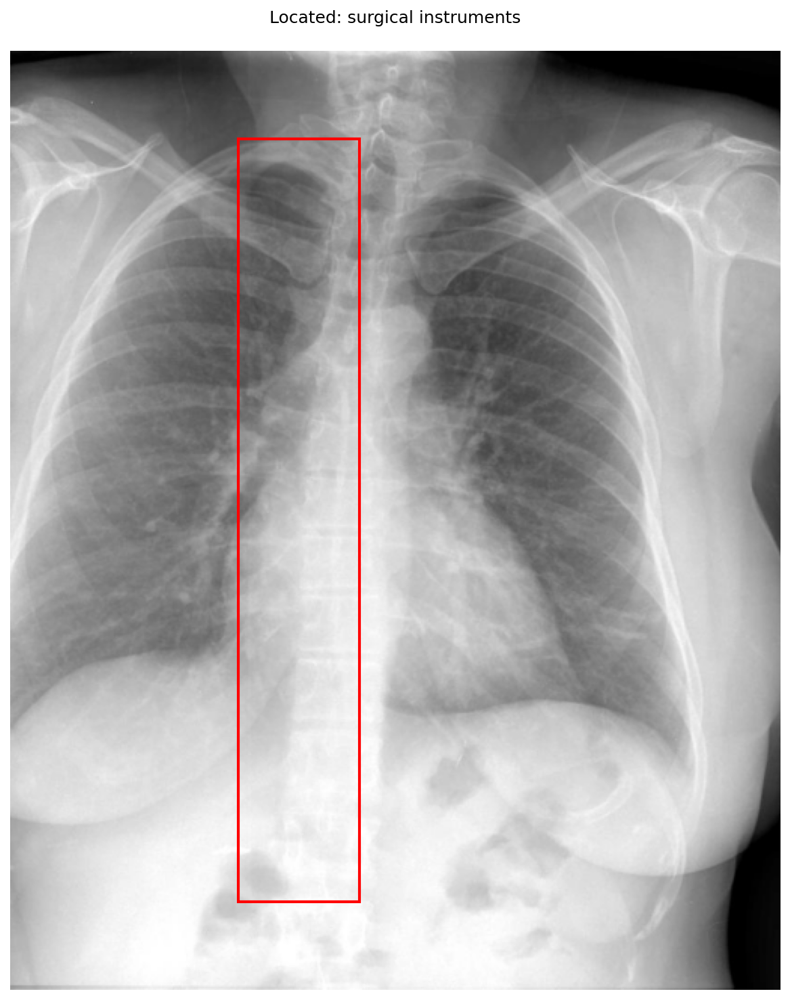

# chexbench_openi_0091
Ordinal 330; source OpenI; stopped-prefix record.

Which finding is in this chest X-ray?

## Complete options

- **A**: surgical instruments in the left lung
- **B**: surgical instruments in the right lung

## Original images

Explicit answer: **A. surgical instruments in the left lung**; reference: **B**; correct: **False**.

The xray_phrase_grounding tool explicitly localized 'surgical instruments' to a bounding box at image coordinates [0.295, 0.005, 0.455, 0.995], which corresponds to the right side of the image and therefore the patient's left lung; while four VQA models reported no instruments, grounding provides direct spatial evidence that overrides their negative textual responses in this forced-choice context.

[Prediction](../../evidence/chexbench/predictions/M43-IM-GT-S50-CXR6/chexbench_openi_0091.json) · [own post-prediction feedback](../../evidence/chexbench/feedback/chexbench_openi_0091.json) · [exact context and Skill version](../../evidence/chexbench/contexts/chexbench_openi_0091.json) · [all main requests/responses](../../evidence/chexbench/services/calls/R50-AGENT/chexbench_openi_0091)

## Tool requests and observations

- medgemma: status=completed; [selection](../../evidence/chexbench/services/tool_selections/R50-AGENT/chexbench_openi_0091/1.json), [full request/result/stdout/stderr artifacts](../../evidence/chexbench/services/tool_cache/8a021dfb27593d9d6ba2112e2d720f657d79b55aa3e8e9cec92ee83186e0fce5).
- xray_phrase_grounding: status=completed; [selection](../../evidence/chexbench/services/tool_selections/R50-AGENT/chexbench_openi_0091/2.json), [full request/result/stdout/stderr artifacts](../../evidence/chexbench/services/tool_cache/b2927c3b48094bd1bbb8bc9da0d789d2ca4d3516b47078a6e4006eaad6aa2e5e).

- chest_xray_expert: status=completed; [selection](../../evidence/chexbench/services/tool_selections/R50-AGENT/chexbench_openi_0091/3.json), [full request/result/stdout/stderr artifacts](../../evidence/chexbench/services/tool_cache/c1a1c6e4eeefbdd3d3d199d9872dc43039d83849bccca4bb3b4289a1001059ba).
- llava_rad: status=completed; [selection](../../evidence/chexbench/services/tool_selections/R50-AGENT/chexbench_openi_0091/4.json), [full request/result/stdout/stderr artifacts](../../evidence/chexbench/services/tool_cache/abfc7ea036e17555df519100aa5fc7540bb1ed327e41762c34458bc87c034d6a).
- llava_med_qa: status=completed; [selection](../../evidence/chexbench/services/tool_selections/R50-AGENT/chexbench_openi_0091/5.json), [full request/result/stdout/stderr artifacts](../../evidence/chexbench/services/tool_cache/eb73cb0882095782bfdfa246e0efbb61b76e50dd8e86fb6bf52ff19a5a39ac5d).
- medvlm_r1: status=completed; [selection](../../evidence/chexbench/services/tool_selections/R50-AGENT/chexbench_openi_0091/6.json), [full request/result/stdout/stderr artifacts](../../evidence/chexbench/services/tool_cache/59717ceb2c10875e62f3c0e6e6241fdcd4807d211085ac84a29a0914bf727bcc).

## Skill and prior-image provenance

Selected IDs: []; prior same-image IDs: [].

This is dataset-label scoring and model/tool narrative, not clinical adjudication or Skill causal verification.
