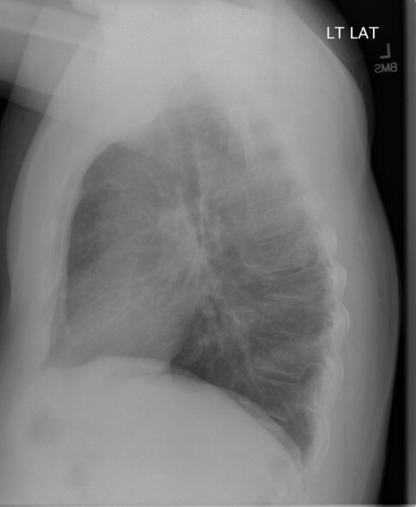

# chexbench_openi_0092
Ordinal 331; source OpenI; stopped-prefix record.

Which finding is in this chest X-ray?

## Complete options

- **A**: right lung opacity
- **B**: left lung opacity

## Original images

Explicit answer: **A. right lung opacity**; reference: **A**; correct: **True**.

Chest X-ray expert identified the opacity as being in the right lung on this lateral view.

[Prediction](../../evidence/chexbench/predictions/M43-IM-GT-S50-CXR6/chexbench_openi_0092.json) · [own post-prediction feedback](../../evidence/chexbench/feedback/chexbench_openi_0092.json) · [exact context and Skill version](../../evidence/chexbench/contexts/chexbench_openi_0092.json) · [all main requests/responses](../../evidence/chexbench/services/calls/R50-AGENT/chexbench_openi_0092)

## Tool requests and observations

- xray_phrase_grounding: status=completed; [selection](../../evidence/chexbench/services/tool_selections/R50-AGENT/chexbench_openi_0092/1.json), [full request/result/stdout/stderr artifacts](../../evidence/chexbench/services/tool_cache/5559bc68c47b08a93c973ab221a8c392873b6ef7b68fe7ebb3d64c80fbbc2d51).
- xray_phrase_grounding: status=completed; [selection](../../evidence/chexbench/services/tool_selections/R50-AGENT/chexbench_openi_0092/2.json), [full request/result/stdout/stderr artifacts](../../evidence/chexbench/services/tool_cache/81b994e5629bfe53948091cee7a265fd790da177b1f872b53f45a0cf43730f63).
- chest_xray_expert: status=completed; [selection](../../evidence/chexbench/services/tool_selections/R50-AGENT/chexbench_openi_0092/3.json), [full request/result/stdout/stderr artifacts](../../evidence/chexbench/services/tool_cache/af7f046a7249c0d01bdf6bb4d56c8cac720354eddfa5cb5ccf1636e85bcfd71a).

## Skill and prior-image provenance

Selected IDs: ['s_39391f294d360026']; prior same-image IDs: [].

Phrase Grounding Verification for Conflicting Binary Choices

1. Identify the two competing options from the question.
2. For each option, construct a specific phrase describing the finding and its location (e.g., 'right lower lobe atelectasis').
3. Call xray_phrase_grounding for the first option's phrase.
4. Check the observation: if predictions list is empty or analysis_status indicates no finding, record as negative.
5. Call xray_phrase_grounding for the second option's phrase.
6. Check the observation: if predictions contain valid bounding boxes, record as positive.
7. Compare results: Select the option with valid grounding boxes. If both have boxes, prefer the one with higher confidence or more precise localization if available; if neither has boxes, re-evaluate or select based on prior probability if forced.
8. Stop when a clear distinction in grounding presence/absence is established between the two options.

Actual source cases: [chexbench_openi_0073](chexbench_openi_0073.md)

This is dataset-label scoring and model/tool narrative, not clinical adjudication or Skill causal verification.
