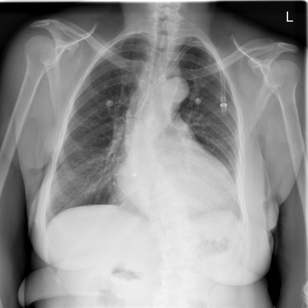
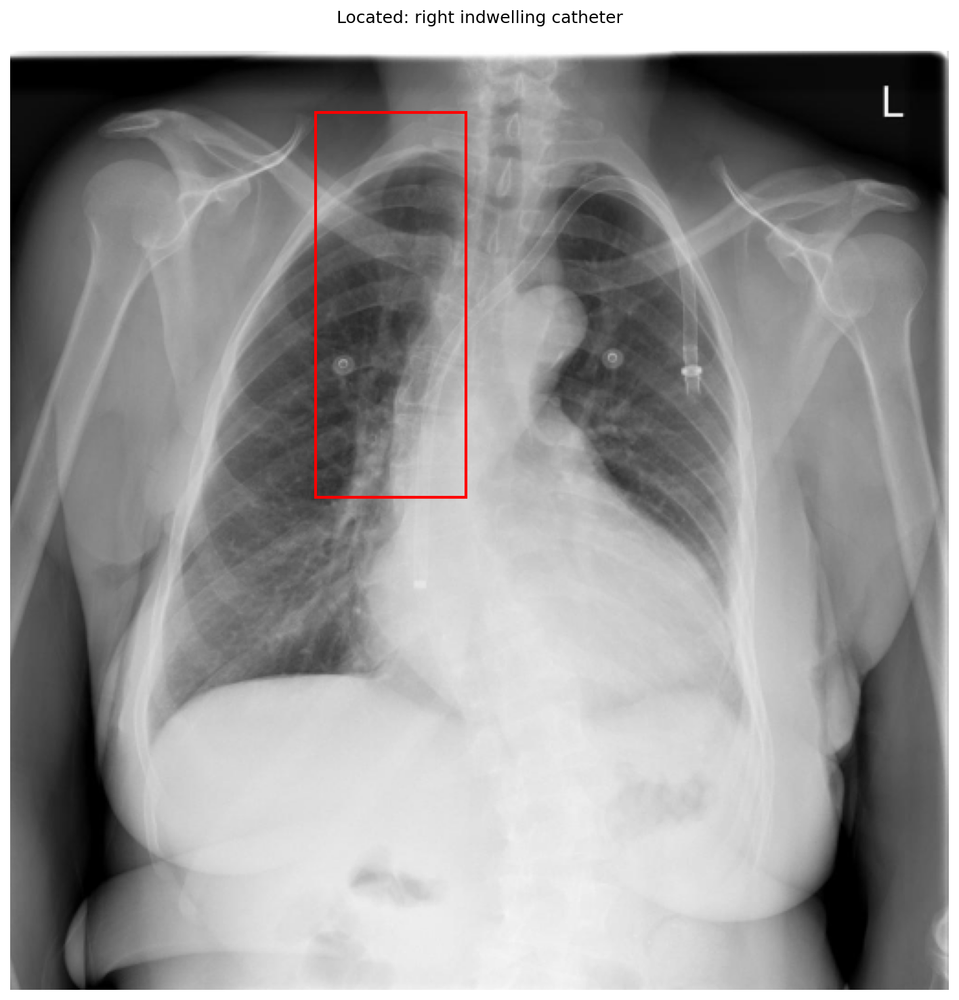
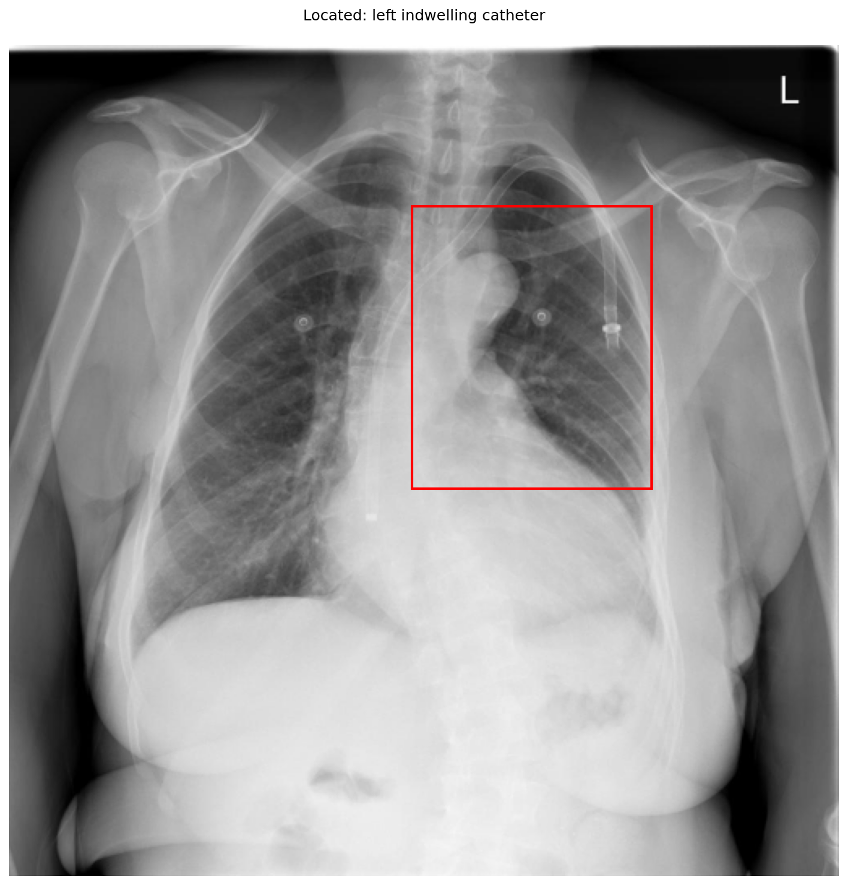

# chexbench_openi_0126
Ordinal 365; source OpenI; stopped-prefix record.

Which finding is in this chest X-ray?

## Complete options

- **A**: right indwelling catheter
- **B**: left indwelling catheter

## Original images

Explicit answer: **B. left indwelling catheter**; reference: **B**; correct: **True**.

The grounding visualization for 'left indwelling catheter' correctly localizes the visible radiopaque line and connector on the patient's left side (image right), whereas the 'right indwelling catheter' box highlights an area without a distinct catheter.

[Prediction](../../evidence/chexbench/predictions/M43-IM-GT-S50-CXR6/chexbench_openi_0126.json) · [own post-prediction feedback](../../evidence/chexbench/feedback/chexbench_openi_0126.json) · [exact context and Skill version](../../evidence/chexbench/contexts/chexbench_openi_0126.json) · [all main requests/responses](../../evidence/chexbench/services/calls/R50-AGENT/chexbench_openi_0126)

## Tool requests and observations

- xray_phrase_grounding: status=completed; [selection](../../evidence/chexbench/services/tool_selections/R50-AGENT/chexbench_openi_0126/1.json), [full request/result/stdout/stderr artifacts](../../evidence/chexbench/services/tool_cache/351c6366a2238b71a9c7c8f0f690be9646911c52b67b3978e0acf94c0017cd8b).

- xray_phrase_grounding: status=completed; [selection](../../evidence/chexbench/services/tool_selections/R50-AGENT/chexbench_openi_0126/2.json), [full request/result/stdout/stderr artifacts](../../evidence/chexbench/services/tool_cache/cd2900fe16ac1681f77478d8eb89ccfc068942095eeae0e397ab69f7b9a25b76).

## Skill and prior-image provenance

Selected IDs: ['s_39391f294d360026']; prior same-image IDs: [].

Phrase Grounding Verification for Conflicting Binary Choices

1. Identify the two competing options from the question.
2. For each option, construct a specific phrase describing the finding and its location (e.g., 'right lower lobe atelectasis').
3. Call xray_phrase_grounding for the first option's phrase.
4. Check the observation: if predictions list is empty or analysis_status indicates no finding, record as negative.
5. Call xray_phrase_grounding for the second option's phrase.
6. Check the observation: if predictions contain valid bounding boxes, record as positive.
7. Compare results: Select the option with valid grounding boxes. If both have boxes, prefer the one with higher confidence or more precise localization if available; if neither has boxes, re-evaluate or select based on prior probability if forced.
8. Stop when a clear distinction in grounding presence/absence is established between the two options.

Actual source cases: [chexbench_openi_0073](chexbench_openi_0073.md)

This is dataset-label scoring and model/tool narrative, not clinical adjudication or Skill causal verification.
