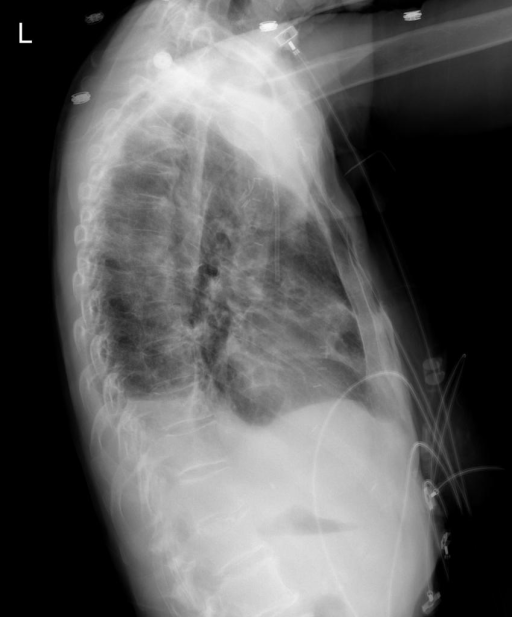

# chexbench_openi_0134
Ordinal 373; source OpenI; stopped-prefix record.

Which finding is in this chest X-ray?

## Complete options

- **A**: right indwelling catheter
- **B**: left indwelling catheter

## Original images

Explicit answer: **A. right indwelling catheter**; reference: **A**; correct: **True**.

Chest X-ray expert model identified the indwelling catheter as being on the right side.

[Prediction](../../evidence/chexbench/predictions/M43-IM-GT-S50-CXR6/chexbench_openi_0134.json) · [own post-prediction feedback](../../evidence/chexbench/feedback/chexbench_openi_0134.json) · [exact context and Skill version](../../evidence/chexbench/contexts/chexbench_openi_0134.json) · [all main requests/responses](../../evidence/chexbench/services/calls/R50-AGENT/chexbench_openi_0134)

## Tool requests and observations

- xray_phrase_grounding: status=completed; [selection](../../evidence/chexbench/services/tool_selections/R50-AGENT/chexbench_openi_0134/1.json), [full request/result/stdout/stderr artifacts](../../evidence/chexbench/services/tool_cache/4d11821097140c78888e1c05ea1cb8b5dda402ae825b6c3933e30b4e7392568f).
- xray_phrase_grounding: status=completed; [selection](../../evidence/chexbench/services/tool_selections/R50-AGENT/chexbench_openi_0134/2.json), [full request/result/stdout/stderr artifacts](../../evidence/chexbench/services/tool_cache/681a6e85c26ffae765f7cd3957a67890cd721e6f73a9f7ff04f6f499a5f6e05a).
- chest_xray_expert: status=completed; [selection](../../evidence/chexbench/services/tool_selections/R50-AGENT/chexbench_openi_0134/3.json), [full request/result/stdout/stderr artifacts](../../evidence/chexbench/services/tool_cache/a7d4389736de3dd01ee6c1d53f4ba83c1e70748a509b4e235e09c51446767a04).

## Skill and prior-image provenance

Selected IDs: ['s_39391f294d360026']; prior same-image IDs: [].

Phrase Grounding Verification for Conflicting Binary Choices

1. Identify the two competing options from the question.
2. For each option, construct a specific phrase describing the finding and its location (e.g., 'right lower lobe atelectasis').
3. Call xray_phrase_grounding for the first option's phrase.
4. Check the observation: if predictions list is empty or analysis_status indicates no finding, record as negative.
5. Call xray_phrase_grounding for the second option's phrase.
6. Check the observation: if predictions contain valid bounding boxes, record as positive.
7. Compare results: Select the option with valid grounding boxes. If both have boxes, prefer the one with higher confidence or more precise localization if available; if neither has boxes, re-evaluate or select based on prior probability if forced.
8. Stop when a clear distinction in grounding presence/absence is established between the two options.

Actual source cases: [chexbench_openi_0073](chexbench_openi_0073.md)

This is dataset-label scoring and model/tool narrative, not clinical adjudication or Skill causal verification.
