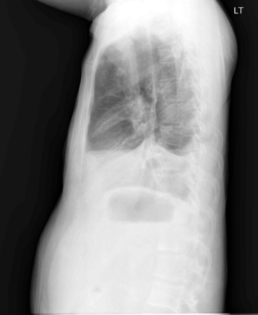

# chexbench_openi_0158
Ordinal 397; source OpenI; stopped-prefix record.

Which finding is in this chest X-ray?

## Complete options

- **A**: large right pleural effusion
- **B**: large left pleural effusion

## Original images

Explicit answer: **A. large right pleural effusion**; reference: **A**; correct: **True**.

Expert model explicitly identified the finding as 'Right' when asked to choose between left and right pleural effusion on this lateral chest X-ray.

[Prediction](../../evidence/chexbench/predictions/M43-IM-GT-S50-CXR6/chexbench_openi_0158.json) · [own post-prediction feedback](../../evidence/chexbench/feedback/chexbench_openi_0158.json) · [exact context and Skill version](../../evidence/chexbench/contexts/chexbench_openi_0158.json) · [all main requests/responses](../../evidence/chexbench/services/calls/R50-AGENT/chexbench_openi_0158)

## Tool requests and observations

- xray_phrase_grounding: status=completed; [selection](../../evidence/chexbench/services/tool_selections/R50-AGENT/chexbench_openi_0158/1.json), [full request/result/stdout/stderr artifacts](../../evidence/chexbench/services/tool_cache/03451494793e032cbb9d1b540547edd6fd56deaec2720272e3ed8194cc655208).
- xray_phrase_grounding: status=completed; [selection](../../evidence/chexbench/services/tool_selections/R50-AGENT/chexbench_openi_0158/2.json), [full request/result/stdout/stderr artifacts](../../evidence/chexbench/services/tool_cache/ad2573c6f86c529ec880a605346a78497cadb06a8eb9461ca49e4eb0b21b01e6).
- chest_xray_expert: status=completed; [selection](../../evidence/chexbench/services/tool_selections/R50-AGENT/chexbench_openi_0158/3.json), [full request/result/stdout/stderr artifacts](../../evidence/chexbench/services/tool_cache/bcaedbbc6e715f68679ae2ac359e7022aba26a7d2d286f4b85535c68dc5e06df).
- chest_xray_expert: status=completed; [selection](../../evidence/chexbench/services/tool_selections/R50-AGENT/chexbench_openi_0158/4.json), [full request/result/stdout/stderr artifacts](../../evidence/chexbench/services/tool_cache/c59e0f430c75184045aa2d1d00568dee518204241dc13eef278934120bb3f7ab).

## Skill and prior-image provenance

Selected IDs: ['s_39391f294d360026']; prior same-image IDs: [].

Phrase Grounding Verification for Conflicting Binary Choices

1. Identify the two competing options from the question.
2. For each option, construct a specific phrase describing the finding and its location (e.g., 'right lower lobe atelectasis').
3. Call xray_phrase_grounding for the first option's phrase.
4. Check the observation: if predictions list is empty or analysis_status indicates no finding, record as negative.
5. Call xray_phrase_grounding for the second option's phrase.
6. Check the observation: if predictions contain valid bounding boxes, record as positive.
7. Compare results: Select the option with valid grounding boxes. If both have boxes, prefer the one with higher confidence or more precise localization if available; if neither has boxes, re-evaluate or select based on prior probability if forced.
8. Stop when a clear distinction in grounding presence/absence is established between the two options.

Actual source cases: [chexbench_openi_0073](chexbench_openi_0073.md)

This is dataset-label scoring and model/tool narrative, not clinical adjudication or Skill causal verification.
