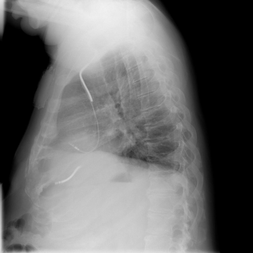

# chexbench_openi_0159
Ordinal 398; source OpenI; stopped-prefix record.

Which finding is in this chest X-ray?

## Complete options

- **A**: small left pleural effusion
- **B**: small right pleural effusion

## Original images

Explicit answer: **A. small left pleural effusion**; reference: **A**; correct: **True**.

LLaVA-Med explicitly identified a small left pleural effusion on the lateral chest X-ray, resolving the side localization after other tools confirmed effusion presence but could not distinguish laterality.

[Prediction](../../evidence/chexbench/predictions/M43-IM-GT-S50-CXR6/chexbench_openi_0159.json) · [own post-prediction feedback](../../evidence/chexbench/feedback/chexbench_openi_0159.json) · [exact context and Skill version](../../evidence/chexbench/contexts/chexbench_openi_0159.json) · [all main requests/responses](../../evidence/chexbench/services/calls/R50-AGENT/chexbench_openi_0159)

## Tool requests and observations

- xray_phrase_grounding: status=completed; [selection](../../evidence/chexbench/services/tool_selections/R50-AGENT/chexbench_openi_0159/1.json), [full request/result/stdout/stderr artifacts](../../evidence/chexbench/services/tool_cache/147df6a9fec83cc87479735cef93fc4879d0f6e2568ef9ffdcd6d69ecd59c6cc).
- xray_phrase_grounding: status=completed; [selection](../../evidence/chexbench/services/tool_selections/R50-AGENT/chexbench_openi_0159/2.json), [full request/result/stdout/stderr artifacts](../../evidence/chexbench/services/tool_cache/81b0d56fe0bf9de409af00b1213cecbbef210c62fa372aacad03616c17687d70).
- chest_xray_expert: status=completed; [selection](../../evidence/chexbench/services/tool_selections/R50-AGENT/chexbench_openi_0159/3.json), [full request/result/stdout/stderr artifacts](../../evidence/chexbench/services/tool_cache/5c609599bee5152733e42d43aa19314e808f037fa2b8f8627e981e2faef27ff8).
- chest_xray_expert: status=completed; [selection](../../evidence/chexbench/services/tool_selections/R50-AGENT/chexbench_openi_0159/4.json), [full request/result/stdout/stderr artifacts](../../evidence/chexbench/services/tool_cache/205dd70454ab1ef3efdf4f2714915c1dff8c70473e346ae83f3e8e8ee680754b).
- llava_rad: status=completed; [selection](../../evidence/chexbench/services/tool_selections/R50-AGENT/chexbench_openi_0159/5.json), [full request/result/stdout/stderr artifacts](../../evidence/chexbench/services/tool_cache/91135a6952a4bb7b19419fb9b69c53317daeefbdf299fce8b72e63ae2a4c960d).
- medvlm_r1: status=completed; [selection](../../evidence/chexbench/services/tool_selections/R50-AGENT/chexbench_openi_0159/6.json), [full request/result/stdout/stderr artifacts](../../evidence/chexbench/services/tool_cache/4183ccb20bf70785645cbe16aa401ac50e9378144a0c4f622abb835c83d6283d).
- llava_med_qa: status=completed; [selection](../../evidence/chexbench/services/tool_selections/R50-AGENT/chexbench_openi_0159/7.json), [full request/result/stdout/stderr artifacts](../../evidence/chexbench/services/tool_cache/8b084e0e4c30cc0f7c9e9c2e306036ff446cfa1c62e33dd96296634f9e6c24e7).

## Skill and prior-image provenance

Selected IDs: ['s_39391f294d360026']; prior same-image IDs: [].

Phrase Grounding Verification for Conflicting Binary Choices

1. Identify the two competing options from the question.
2. For each option, construct a specific phrase describing the finding and its location (e.g., 'right lower lobe atelectasis').
3. Call xray_phrase_grounding for the first option's phrase.
4. Check the observation: if predictions list is empty or analysis_status indicates no finding, record as negative.
5. Call xray_phrase_grounding for the second option's phrase.
6. Check the observation: if predictions contain valid bounding boxes, record as positive.
7. Compare results: Select the option with valid grounding boxes. If both have boxes, prefer the one with higher confidence or more precise localization if available; if neither has boxes, re-evaluate or select based on prior probability if forced.
8. Stop when a clear distinction in grounding presence/absence is established between the two options.

Actual source cases: [chexbench_openi_0073](chexbench_openi_0073.md)

This is dataset-label scoring and model/tool narrative, not clinical adjudication or Skill causal verification.
