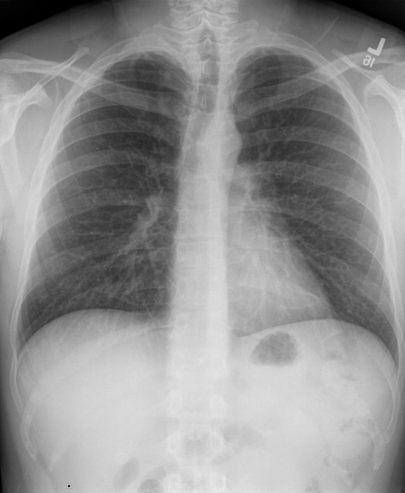

# chexbench_openi_0167
Ordinal 406; source OpenI; stopped-prefix record.

Which finding is in this chest X-ray?

## Complete options

- **A**: left abdominal calcinosis
- **B**: right abdominal calcinosis

## Original images

Explicit answer: **B. right abdominal calcinosis**; reference: **B**; correct: **True**.

CheXagent explicitly identified the abdominal calcinosis as being on the right side, while phrase grounding failed to localize either option.

[Prediction](../../evidence/chexbench/predictions/M43-IM-GT-S50-CXR6/chexbench_openi_0167.json) · [own post-prediction feedback](../../evidence/chexbench/feedback/chexbench_openi_0167.json) · [exact context and Skill version](../../evidence/chexbench/contexts/chexbench_openi_0167.json) · [all main requests/responses](../../evidence/chexbench/services/calls/R50-AGENT/chexbench_openi_0167)

## Tool requests and observations

- xray_phrase_grounding: status=completed; [selection](../../evidence/chexbench/services/tool_selections/R50-AGENT/chexbench_openi_0167/1.json), [full request/result/stdout/stderr artifacts](../../evidence/chexbench/services/tool_cache/7534f0fc2a16d8a7e715afa6323cd9249be57953e96d1c41c8da1eb8c14831f7).
- xray_phrase_grounding: status=completed; [selection](../../evidence/chexbench/services/tool_selections/R50-AGENT/chexbench_openi_0167/2.json), [full request/result/stdout/stderr artifacts](../../evidence/chexbench/services/tool_cache/de3061037308cbb0894fb3bec394b1599ce324b1fbeffb485973a45370ab993c).
- medgemma: status=completed; [selection](../../evidence/chexbench/services/tool_selections/R50-AGENT/chexbench_openi_0167/3.json), [full request/result/stdout/stderr artifacts](../../evidence/chexbench/services/tool_cache/faaf4a073caab1847a4f8cc72ab7b29d0e152af51a1203734d5c1fe4aba5471a).
- chest_xray_expert: status=completed; [selection](../../evidence/chexbench/services/tool_selections/R50-AGENT/chexbench_openi_0167/4.json), [full request/result/stdout/stderr artifacts](../../evidence/chexbench/services/tool_cache/38508358977a6309e3646666603ab59d0bf8b7bfaf3a75a0ccef3c777dc84bf4).
- chest_xray_expert: status=completed; [selection](../../evidence/chexbench/services/tool_selections/R50-AGENT/chexbench_openi_0167/5.json), [full request/result/stdout/stderr artifacts](../../evidence/chexbench/services/tool_cache/8b3ceb22f66147ef7584d1f775656ecc68384d90e3b45a80de08d6507e6e3b45).

## Skill and prior-image provenance

Selected IDs: ['s_39391f294d360026']; prior same-image IDs: [].

Phrase Grounding Verification for Conflicting Binary Choices

1. Identify the two competing options from the question.
2. For each option, construct a specific phrase describing the finding and its location (e.g., 'right lower lobe atelectasis').
3. Call xray_phrase_grounding for the first option's phrase.
4. Check the observation: if predictions list is empty or analysis_status indicates no finding, record as negative.
5. Call xray_phrase_grounding for the second option's phrase.
6. Check the observation: if predictions contain valid bounding boxes, record as positive.
7. Compare results: Select the option with valid grounding boxes. If both have boxes, prefer the one with higher confidence or more precise localization if available; if neither has boxes, re-evaluate or select based on prior probability if forced.
8. Stop when a clear distinction in grounding presence/absence is established between the two options.

Actual source cases: [chexbench_openi_0073](chexbench_openi_0073.md)

This is dataset-label scoring and model/tool narrative, not clinical adjudication or Skill causal verification.
