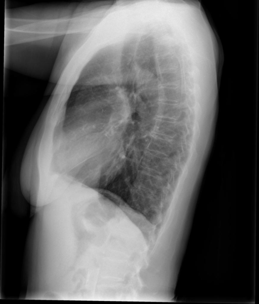

# chexbench_openi_0178
Ordinal 417; source OpenI; stopped-prefix record.

Which finding is in this chest X-ray?

## Complete options

- **A**: left upper lobe pulmonary atelectasis
- **B**: right upper lobe pulmonary atelectasis

## Original images

Explicit answer: **B. right upper lobe pulmonary atelectasis**; reference: **B**; correct: **True**.

LLaVA-Med QA identified the upper lobe opacity as anteriorly located on the lateral view, which is characteristic of right upper lobe atelectasis.

[Prediction](../../evidence/chexbench/predictions/M43-IM-GT-S50-CXR6/chexbench_openi_0178.json) · [own post-prediction feedback](../../evidence/chexbench/feedback/chexbench_openi_0178.json) · [exact context and Skill version](../../evidence/chexbench/contexts/chexbench_openi_0178.json) · [all main requests/responses](../../evidence/chexbench/services/calls/R50-AGENT/chexbench_openi_0178)

## Tool requests and observations

- xray_phrase_grounding: status=completed; [selection](../../evidence/chexbench/services/tool_selections/R50-AGENT/chexbench_openi_0178/1.json), [full request/result/stdout/stderr artifacts](../../evidence/chexbench/services/tool_cache/0b341f43b8fe2c1e6d9dfbb9595314b948187e0174894638972f4509433a5a37).
- xray_phrase_grounding: status=completed; [selection](../../evidence/chexbench/services/tool_selections/R50-AGENT/chexbench_openi_0178/2.json), [full request/result/stdout/stderr artifacts](../../evidence/chexbench/services/tool_cache/a4991938efbdbb5d1309bbf8483157ddccd5c653ceeb86f9a3e5244b7a0227f2).
- chest_xray_expert: status=completed; [selection](../../evidence/chexbench/services/tool_selections/R50-AGENT/chexbench_openi_0178/3.json), [full request/result/stdout/stderr artifacts](../../evidence/chexbench/services/tool_cache/f9c28a80d6a1d8af9d5474d83707a148142e4b27c38bbc97ff5bce12bd19bbcf).
- llava_rad: status=completed; [selection](../../evidence/chexbench/services/tool_selections/R50-AGENT/chexbench_openi_0178/4.json), [full request/result/stdout/stderr artifacts](../../evidence/chexbench/services/tool_cache/e428a8fcebc33ea914fd6fa07725f563849fd54f7e5680e67849b530ea8613e1).
- medvlm_r1: status=completed; [selection](../../evidence/chexbench/services/tool_selections/R50-AGENT/chexbench_openi_0178/5.json), [full request/result/stdout/stderr artifacts](../../evidence/chexbench/services/tool_cache/77810550ca2b2851e5bead2d994b0d70915a72ea838e745090ac46fa1545fda7).
- medgemma: status=completed; [selection](../../evidence/chexbench/services/tool_selections/R50-AGENT/chexbench_openi_0178/6.json), [full request/result/stdout/stderr artifacts](../../evidence/chexbench/services/tool_cache/4e46c2ce1028effbb62afb31f732769926b35cdc437c834b09f86fa9bfcc0e50).
- llava_med_qa: status=completed; [selection](../../evidence/chexbench/services/tool_selections/R50-AGENT/chexbench_openi_0178/7.json), [full request/result/stdout/stderr artifacts](../../evidence/chexbench/services/tool_cache/cc148f92b3f151181c1424a82001e71ad0d36e2c3eaea681d1fbb251fca66bb6).

## Skill and prior-image provenance

Selected IDs: ['s_39391f294d360026']; prior same-image IDs: [].

Phrase Grounding Verification for Conflicting Binary Choices

1. Identify the two competing options from the question.
2. For each option, construct a specific phrase describing the finding and its location (e.g., 'right lower lobe atelectasis').
3. Call xray_phrase_grounding for the first option's phrase.
4. Check the observation: if predictions list is empty or analysis_status indicates no finding, record as negative.
5. Call xray_phrase_grounding for the second option's phrase.
6. Check the observation: if predictions contain valid bounding boxes, record as positive.
7. Compare results: Select the option with valid grounding boxes. If both have boxes, prefer the one with higher confidence or more precise localization if available; if neither has boxes, re-evaluate or select based on prior probability if forced.
8. Stop when a clear distinction in grounding presence/absence is established between the two options.

Actual source cases: [chexbench_openi_0073](chexbench_openi_0073.md)

This is dataset-label scoring and model/tool narrative, not clinical adjudication or Skill causal verification.
