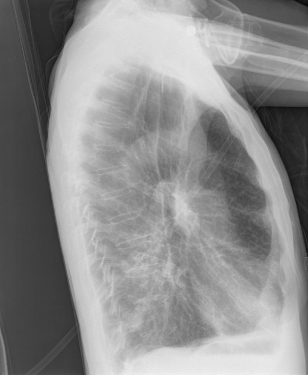
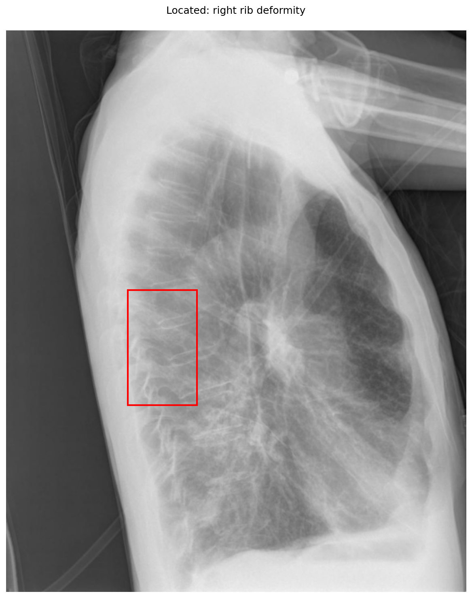
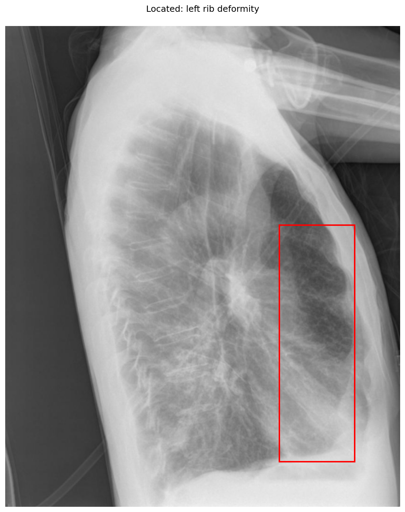

# chexbench_openi_0180
Ordinal 419; source OpenI; stopped-prefix record.

Which finding is in this chest X-ray?

## Complete options

- **A**: right rib deformity
- **B**: left rib deformity

## Original images

Explicit answer: **A. right rib deformity**; reference: **B**; correct: **False**.

Phrase grounding localized the rib deformity to the anterior chest wall (x=0.26-0.41), which corresponds to the right side in this lateral projection, whereas the left-sided box targeted the posterior lung field.

[Prediction](../../evidence/chexbench/predictions/M43-IM-GT-S50-CXR6/chexbench_openi_0180.json) · [own post-prediction feedback](../../evidence/chexbench/feedback/chexbench_openi_0180.json) · [exact context and Skill version](../../evidence/chexbench/contexts/chexbench_openi_0180.json) · [all main requests/responses](../../evidence/chexbench/services/calls/R50-AGENT/chexbench_openi_0180)

## Tool requests and observations

- xray_phrase_grounding: status=completed; [selection](../../evidence/chexbench/services/tool_selections/R50-AGENT/chexbench_openi_0180/1.json), [full request/result/stdout/stderr artifacts](../../evidence/chexbench/services/tool_cache/2ac52d08e55545466d8207a2318d3d192b51b4622632bf304e0e6bd2df281984).

- xray_phrase_grounding: status=completed; [selection](../../evidence/chexbench/services/tool_selections/R50-AGENT/chexbench_openi_0180/2.json), [full request/result/stdout/stderr artifacts](../../evidence/chexbench/services/tool_cache/fd5c38d658a3117030454c3f3aa2d632ea5fd686ce0c3762d7363327a8ceb0c8).

## Skill and prior-image provenance

Selected IDs: ['s_39391f294d360026']; prior same-image IDs: [].

Phrase Grounding Verification for Conflicting Binary Choices

1. Identify the two competing options from the question.
2. For each option, construct a specific phrase describing the finding and its location (e.g., 'right lower lobe atelectasis').
3. Call xray_phrase_grounding for the first option's phrase.
4. Check the observation: if predictions list is empty or analysis_status indicates no finding, record as negative.
5. Call xray_phrase_grounding for the second option's phrase.
6. Check the observation: if predictions contain valid bounding boxes, record as positive.
7. Compare results: Select the option with valid grounding boxes. If both have boxes, prefer the one with higher confidence or more precise localization if available; if neither has boxes, re-evaluate or select based on prior probability if forced.
8. Stop when a clear distinction in grounding presence/absence is established between the two options.

Actual source cases: [chexbench_openi_0073](chexbench_openi_0073.md)

This is dataset-label scoring and model/tool narrative, not clinical adjudication or Skill causal verification.
