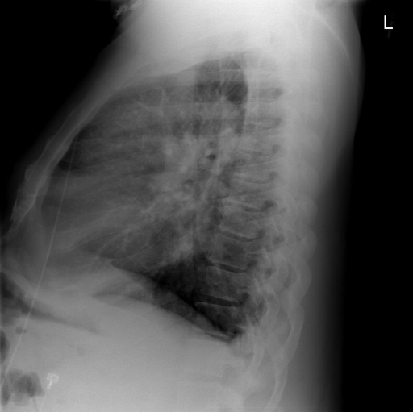
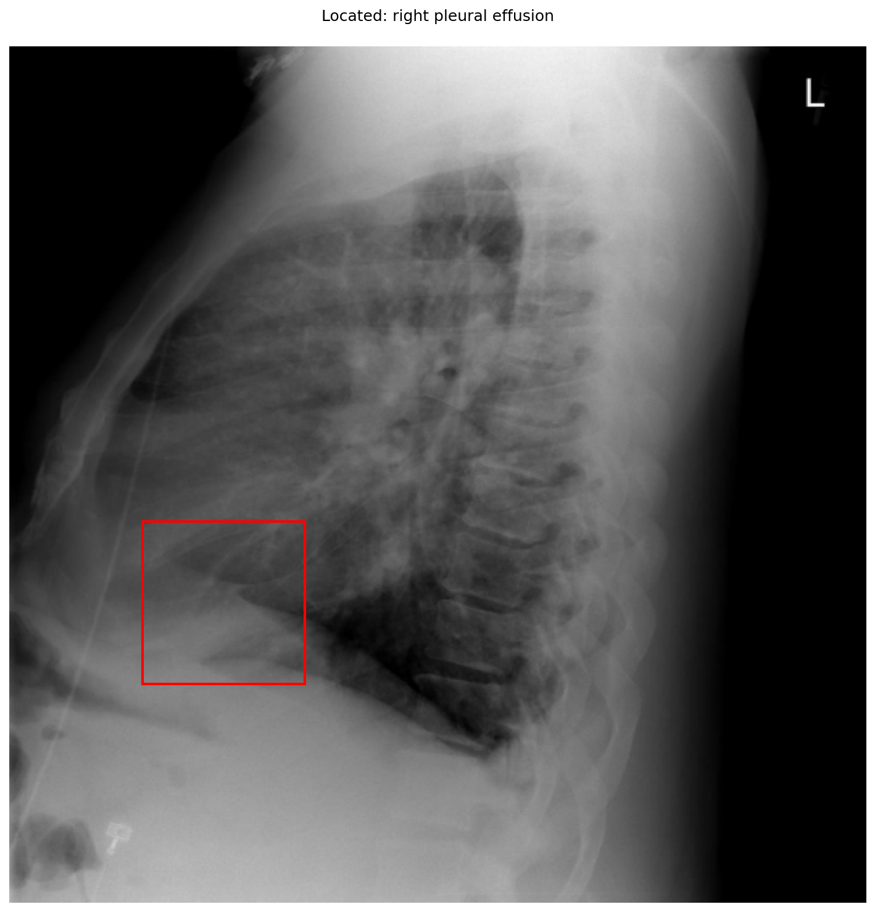
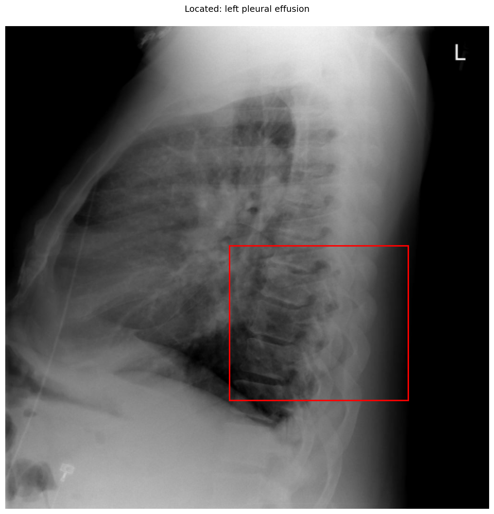

# chexbench_openi_0187
Ordinal 426; source OpenI; stopped-prefix record.

Which finding is in this chest X-ray?

## Complete options

- **A**: right pleural effusion
- **B**: left pleural effusion

## Original images

Explicit answer: **A. right pleural effusion**; reference: **A**; correct: **True**.

The phrase grounding for 'right pleural effusion' localizes to the anterior costophrenic angle (typical for lateral view effusion), whereas the 'left pleural effusion' box incorrectly targets the posterior spine.

[Prediction](../../evidence/chexbench/predictions/M43-IM-GT-S50-CXR6/chexbench_openi_0187.json) · [own post-prediction feedback](../../evidence/chexbench/feedback/chexbench_openi_0187.json) · [exact context and Skill version](../../evidence/chexbench/contexts/chexbench_openi_0187.json) · [all main requests/responses](../../evidence/chexbench/services/calls/R50-AGENT/chexbench_openi_0187)

## Tool requests and observations

- xray_phrase_grounding: status=completed; [selection](../../evidence/chexbench/services/tool_selections/R50-AGENT/chexbench_openi_0187/1.json), [full request/result/stdout/stderr artifacts](../../evidence/chexbench/services/tool_cache/7c70539dd02bd9e04354e9dd12f0a123073c97602b3df72baad0bd0eb72526b2).

- xray_phrase_grounding: status=completed; [selection](../../evidence/chexbench/services/tool_selections/R50-AGENT/chexbench_openi_0187/2.json), [full request/result/stdout/stderr artifacts](../../evidence/chexbench/services/tool_cache/3395b2ce7392cbc65a3ab7b57b520c33852cc3194c6cba75412953eeb048721a).

## Skill and prior-image provenance

Selected IDs: ['s_39391f294d360026']; prior same-image IDs: [].

Phrase Grounding Verification for Conflicting Binary Choices

1. Identify the two competing options from the question.
2. For each option, construct a specific phrase describing the finding and its location (e.g., 'right lower lobe atelectasis').
3. Call xray_phrase_grounding for the first option's phrase.
4. Check the observation: if predictions list is empty or analysis_status indicates no finding, record as negative.
5. Call xray_phrase_grounding for the second option's phrase.
6. Check the observation: if predictions contain valid bounding boxes, record as positive.
7. Compare results: Select the option with valid grounding boxes. If both have boxes, prefer the one with higher confidence or more precise localization if available; if neither has boxes, re-evaluate or select based on prior probability if forced.
8. Stop when a clear distinction in grounding presence/absence is established between the two options.

Actual source cases: [chexbench_openi_0073](chexbench_openi_0073.md)

This is dataset-label scoring and model/tool narrative, not clinical adjudication or Skill causal verification.
