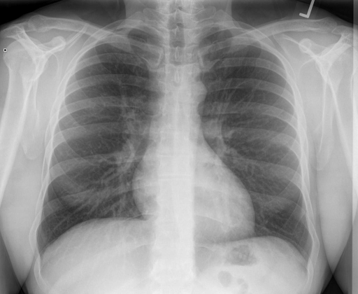

# chexbench_rad_restruct_0123
Ordinal 1; source Rad-Restruct; stopped-prefix record.

Is there anything abnormal in the lung?

## Complete options

- **A**: yes
- **B**: no

## Original images

Explicit answer: **B. no**; reference: **B**; correct: **True**.

Three of four VLMs (medgemma, llava_rad, and visual inspection) report clear lungs with no acute pathology; the single contradictory 'Yes' from chest_xray_expert is outweighed by consistent negative findings across other models.

[Prediction](../../evidence/chexbench/predictions/M43-IM-GT-S50-CXR6/chexbench_rad_restruct_0123.json) · [own post-prediction feedback](../../evidence/chexbench/feedback/chexbench_rad_restruct_0123.json) · [exact context and Skill version](../../evidence/chexbench/contexts/chexbench_rad_restruct_0123.json) · [all main requests/responses](../../evidence/chexbench/services/calls/R50-AGENT/chexbench_rad_restruct_0123)

## Tool requests and observations

- medgemma: status=completed; [selection](../../evidence/chexbench/services/tool_selections/R50-AGENT/chexbench_rad_restruct_0123/1.json), [full request/result/stdout/stderr artifacts](../../evidence/chexbench/services/tool_cache/7d477a17480446294a565f4785c6d9883203a23122d62c93a2e990534aeae9b0).
- chest_xray_expert: status=completed; [selection](../../evidence/chexbench/services/tool_selections/R50-AGENT/chexbench_rad_restruct_0123/2.json), [full request/result/stdout/stderr artifacts](../../evidence/chexbench/services/tool_cache/15085f5f3af7c88f38bc4faf8f051de040bbf67e87ef2502e9a9d9d404c25f62).
- llava_rad: status=completed; [selection](../../evidence/chexbench/services/tool_selections/R50-AGENT/chexbench_rad_restruct_0123/3.json), [full request/result/stdout/stderr artifacts](../../evidence/chexbench/services/tool_cache/eb4375051fa24be8e5a060c3b8f71b11dc06e607893a5a42cb4d6e19f26b5e15).
- medvlm_r1: status=completed; [selection](../../evidence/chexbench/services/tool_selections/R50-AGENT/chexbench_rad_restruct_0123/4.json), [full request/result/stdout/stderr artifacts](../../evidence/chexbench/services/tool_cache/c08867b2da348b4676bd4bfcd5aa0c5a4285b20a8bef0c4d5519220985affc99).

## Skill and prior-image provenance

Selected IDs: []; prior same-image IDs: [].

This is dataset-label scoring and model/tool narrative, not clinical adjudication or Skill causal verification.
