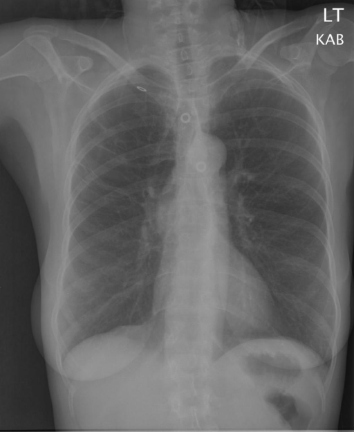

# chexbench_rad_restruct_0125
Ordinal 3; source Rad-Restruct; stopped-prefix record.

Is there anything abnormal in the skeletal system?

## Complete options

- **A**: no
- **B**: yes

## Original images

Explicit answer: **A. no**; reference: **A**; correct: **True**.

Both expert models confirm no visible fractures, lytic lesions, or skeletal deformities in the ribs, clavicles, or spine.

[Prediction](../../evidence/chexbench/predictions/M43-IM-GT-S50-CXR6/chexbench_rad_restruct_0125.json) · [own post-prediction feedback](../../evidence/chexbench/feedback/chexbench_rad_restruct_0125.json) · [exact context and Skill version](../../evidence/chexbench/contexts/chexbench_rad_restruct_0125.json) · [all main requests/responses](../../evidence/chexbench/services/calls/R50-AGENT/chexbench_rad_restruct_0125)

## Tool requests and observations

- medgemma: status=completed; [selection](../../evidence/chexbench/services/tool_selections/R50-AGENT/chexbench_rad_restruct_0125/1.json), [full request/result/stdout/stderr artifacts](../../evidence/chexbench/services/tool_cache/ebc258549592f51ccd2775a6cf6f6ecc331174b901dfcd2a02e704bb89294f25).
- chest_xray_expert: status=completed; [selection](../../evidence/chexbench/services/tool_selections/R50-AGENT/chexbench_rad_restruct_0125/2.json), [full request/result/stdout/stderr artifacts](../../evidence/chexbench/services/tool_cache/aa98fcb27d4e73fc38b50f0ac5518c803bef591e9c4ae76796fe5b4e633ce6f6).

## Skill and prior-image provenance

Selected IDs: []; prior same-image IDs: [].

This is dataset-label scoring and model/tool narrative, not clinical adjudication or Skill causal verification.
